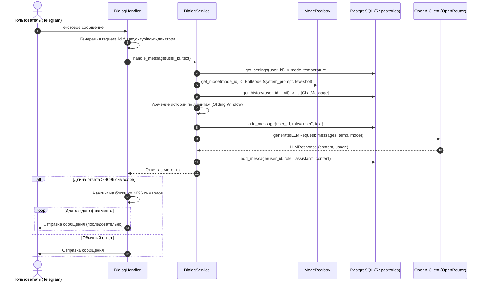

# Отчёт по Лабораторной работе № 1

**Тема:** Разработка Telegram-бота «AI-ассистент студента» с языковой моделью  
**Дисциплина:** Искусственный интеллект в разработке программного обеспечения  
**Университет:** Университет ИТМО  
**Репозиторий:** [https://github.com/KryptonFox/ai-in-sd-bot](https://github.com/KryptonFox/ai-in-sd-bot)  
**Тег репозитория:** `lab1`  

---

## 1. Цель работы и выбранный провайдер модели

### 1.1. Цель работы
Освоение практических навыков интеграции диалогового Telegram-бота с большими языковыми моделями (LLM) через стандартизированный OpenAI-совместимый REST API. Разделение ответственности в архитектуре приложения, реализация надежного изолированного контекста пользователей на базе PostgreSQL, защита секретов и трассировка вызовов, а также экспериментальное исследование влияния параметров генерации (`temperature`) и структуры промптов на поведение модели.

### 1.2. Провайдер и модель
* **API-провайдер:** [OpenRouter](https://openrouter.ai/) (`https://openrouter.ai/api/v1`).
* **Модель:** `nvidia/nemotron-3-ultra-550b-a55b:free`.
* **Обоснование выбора:** Данная модель обладает параметрами 550B, поддерживает полноценные системные инструкции (`role: system`), корректно обрабатывает параметр вариативности `temperature` в диапазоне от `0.0` до `1.0`, доступна через OpenAI-совместимый протокол без блокировок биллинга и обеспечивает высокое качество рассуждений на русском языке по вопросам computer science и программирования.

---

## 2. Схема прохождения сообщения через приложение

В архитектуре приложения реализовано строгое разделение уровней (Clean Architecture):
1. **Слой представления (Telegram Handlers):** приём апдейтов, фильтрация личных сообщений, отправка индикатора набора текста (`chat_action="typing"`), разбиение ответов длиннее 4096 символов.
2. **Сервисный слой (`DialogService`):** координация бизнес-логики, сборка контекста, применение скользящего окна усечения истории, оркестрация вызова LLM и атомарное сохранение сообщений в БД.
3. **Репозиторный слой (`HistoryRepository`, `UserSettingsRepository`):** параметризованные асинхронные SQL-запросы к PostgreSQL через пул `asyncpg`.
4. **Реестр режимов (`ModeRegistry`):** управление системными промптами и few-shot примерами без хардкода.
5. **Клиентский слой (`OpenAIClient`):** асинхронный HTTP-клиент на базе `httpx` с обработкой сетевых таймаутов, безопасным логированием и защитой от утечки учетных данных.

### Схема взаимодействия компонентов



---

## 3. Хранение и ограничение контекста

### 3.1. Схема данных в PostgreSQL
Для персистентного хранения данных между перезапусками приложения созданы две таблицы с миграционным контролем (таблица `schema_migrations`, контроль SHA-256 и блокировка `pg_advisory_lock`):
1. **`user_settings`**:
   * `user_id` (`BIGINT PRIMARY KEY`) — уникальный идентификатор пользователя Telegram.
   * `current_mode` (`VARCHAR(32) NOT NULL DEFAULT 'study'`) — активный режим.
   * `temperature` (`NUMERIC(3, 1) NOT NULL DEFAULT 0.7`) — индивидуальная температура генерации (`0.0`, `0.3`, `0.7`, `1.0`).
   * `updated_at` (`TIMESTAMPTZ NOT NULL DEFAULT NOW()`).
2. **`dialog_messages`**:
   * `id` (`BIGSERIAL PRIMARY KEY`).
   * `user_id` (`BIGINT NOT NULL REFERENCES user_settings(user_id) ON DELETE CASCADE`).
   * `role` (`VARCHAR(16) NOT NULL CHECK (role IN ('user', 'assistant', 'system', 'tool'))`).
   * `content` (`TEXT NOT NULL`).
   * `metadata` (`JSONB NOT NULL DEFAULT '{}'::jsonb`).
   * `created_at` (`TIMESTAMPTZ NOT NULL DEFAULT NOW()`).
   * Индекс: `CREATE INDEX idx_dialog_messages_user_created ON dialog_messages (user_id, created_at ASC)`.

Схема заранее адаптирована под требования Лабораторных № 2 и № 3: поддерживает роли `tool` и произвольные метаданные `metadata` (аргументы вызова инструментов и `tool_call_id`).

### 3.2. Стратегия ограничения контекста
Контекстное окно языковой модели конечно, поэтому в сервисе реализован алгоритм **скользящего окна (Sliding Window)** с двойным контролем:
* **Лимит по числу сообщений:** `MAX_HISTORY_MESSAGES = 10` (настраивается в конфигурации).
* **Лимит по объёму:** `MAX_HISTORY_CHARS = 8000` символов (эвристически ~2000–2500 токенов).

**Правила работы алгоритма:**
1. Системный промпт активного режима и текущий входящий запрос пользователя **никогда не отсекаются**.
2. Из базы данных извлекаются последние $N$ сообщений в хронологическом порядке.
3. Если суммарная длина истории превышает `MAX_HISTORY_CHARS`, самые старые сообщения отбрасываются слева, пока объем не войдет в лимит.
4. Оставшиеся сообщения передаются в модель с сохранением ролей `user` и `assistant`.
5. Если обращение к API модели завершается ошибкой (сетевой таймаут, 5xx от сервиса, пустой ответ), сообщение ассистента **не сохраняется в базу данных**, что исключает рассинхронизацию диалога.

---

## 4. Системные инструкции режимов и разбор их элементов

В боте реализовано три режима работы, зарегистрированных в реестре `ModeRegistry`:

### 4.1. Режим `/study` (Обучение)
* **Назначение:** Персональный ментор по программированию.
* **Структура по мнемонике R.C.T.F.:**
  * **Role:** *«Опытный преподаватель и ментор по программированию»* — задаёт экспертный, поддерживающий и дидактический тон.
  * **Context:** *«Студент изучает разработку ПО, алгоритмы, базы данных и архитектуру приложений»* — ориентирует модель на уровень университетского студента, избегая как излишней примитивизации, так и академической заумности.
  * **Task:** *«Объясняй концепции понятно, структурированно и лаконично. Приводи минимальные, легко читаемые примеры кода. Обращай внимание на частые ошибки новичков»*.
  * **Format:** *«Ответ на русском языке. Сначала краткая суть, затем практический пример кода с пояснениями, в конце — 1-2 ключевых вывода или рекомендации. Без лишней 'воды'»*.

### 4.2. Режим `/translate` (Технический переводчик)
* **Назначение:** Перевод технической документации, комментариев и кода.
* **Структура:**
  * **Role:** Профессиональный технический IT-переводчик.
  * **Context:** Пользователь отправляет документацию к API, сообщения коммитов или фрагменты кода.
  * **Task:** Перевод с сохранением устоявшихся IT-терминов, без перевода ключевых слов языка программирования, имён идентификаторов и переменных.
  * **Format:** Строго текст перевода без ритуальных вводных конструкций («Вот ваш перевод:»), с опциональным глоссарием редких терминов.

### 4.3. Режим `/review` (Код-ревью с few-shot примером)
* **Назначение:** Анализ присланного кода на дефекты, оценку алгоритмической сложности и чистоту кода.
* **Промпт с Few-Shot обучением:**
  Модель получает четкую трехуровневую структуру вывода (`### 1. Найденные проблемы`, `### 2. Сложность`, `### 3. Улучшенный вариант кода`), подкрепленную демонстрационным примером:
  * *Входной пример (User):* неоптимальная функция поиска дубликатов со сложностью $O(N^2)$ через вложенный цикл.
  * *Ожидаемый ответ (Assistant):* выявление алгоритмической неэффективности, указание $O(N^2)$ по времени, демонстрация решения через структуру данных `set()` со сложностью $O(N)$.

---

## 5. Экспериментальные запуски и исследование влияния `temperature`

### 5.1. Условия эксперимента
* **Тестовый запрос:** *«Объясни разницу между процессами и потоками в ОС, и в каких случаях в Python использовать multiprocessing вместо threading»*.
* **Активный режим:** `/study` (системный промпт ментора).
* **Модель:** `nvidia/nemotron-3-ultra-550b-a55b:free`.
* **Ограничение токенов:** `max_tokens = 1500`.
* **Протокол:** 4 значения температуры (`0.0`, `0.3`, `0.7`, `1.0`), по 3 независимых повтора на каждое значение (всего 12 запусков) со сбросом контекста перед каждым запросом.

### 5.2. Сводная таблица 12 запусков

| № | Temp | Время (с) | Символы | Токены (prompt / comp / total) | Формат (суть + код + выводы) | Ключевые наблюдения |
|---|:---:|:---:|:---:|:---:|:---:|---|
| 1 | 0.0 | 40.8 | 2051 | 195 / 736 / 931 | Да | Детерминированное лаконичное введение, выделение раздельной памяти процессов и общей памяти потоков, упоминание GIL |
| 2 | 0.0 | 17.0 | 2244 | 195 / 789 / 984 | Да | Строгая структура, акцент на CPU-bound vs I/O-bound, предупреждение о частой ошибке новичков |
| 3 | 0.0 | 36.1 | 2479 | 195 / 869 / 1064 | Да | Детальное пояснение pickle и накладных расходов копирования данных при межпроцессном взаимодействии |
| 4 | 0.3 | 29.4 | 3061 | 195 / 1080 / 1275 | Да | Комплексный бенчмарк с `perf_counter` для I/O и CPU, проверка `__name__ == '__main__'` для spawn |
| 5 | 0.3 | 48.0 | 2893 | 195 / 1014 / 1209 | Да | Наглядная сравнительная таблица в тексте, пример с `ThreadPoolExecutor` и `requests` |
| 6 | 0.3 | 71.8 | 3716 | 195 / 1283 / 1478 | Да | Развернутый разбор ошибок segfault при потоках, `multiprocessing.Pool.starmap` |
| 7 | 0.7 | 24.7 | 3554 | 195 / 1202 / 1397 | Да | Живой язык, развернутый бенчмарк с замером времени суммарного vs параллельного исполнения |
| 8 | 0.7 | 27.1 | 3231 | 195 / 1104 / 1299 | Да | Использование современного модуля `concurrent.futures`, рекомендации не передавать гигантские объекты |
| 9 | 0.7 | 45.7 | 2375 | 195 / 828 / 1023 | Да | Сфокусированное объяснение, альтернативный компактный пример сетевого запроса |
| 10 | 1.0 | 28.0 | 3175 | 195 / 1114 / 1309 | Да | Максимальная вариативность: задействован `multiprocessing.pool.ThreadPool`, акцент на Copy-on-Write |
| 11 | 1.0 | 34.8 | 3508 | 195 / 1229 / 1424 | Да | Дополнительные рекомендации по `shared_memory` и `mmap` для избежания накладных расходов pickle |
| 12 | 1.0 | 48.4 | 3530 | 195 / 1238 / 1433 | Да | Разбор ловушек новичка: непиклируемые объекты (лямбды, сокеты, коннекты к БД), рекурсивный spawn |

### 5.3. Анализ качества и вариативности
1. **Детерминизм и стабильность при низких температурах (`temperature = 0.0` и `0.3`):**
   * Ответы отличаются максимальной лаконичностью (~2000–2400 символов при `0.0`), строгим следованием схеме R.C.T.F. и наименьшим числом токенов генерации (736–869).
   * При росте до `0.3` модель формирует более развернутые практические бенчмарки (1014–1283 токена).
2. **Влияние роста температуры (`temperature = 0.7` и `1.0`):**
   * С ростом `temperature` средний объём ответа увеличивается до 3200–3550 символов (1100–1238 токенов генерации).
   * При `0.7` и `1.0` модель предлагает более глубокие системные детали: обсуждение нюансов модели `spawn` на Windows/macOS, механизма Copy-on-Write при `fork` в Linux, а также ограничения сериализации `pickle` (невозможность передачи дескрипторов файлов и сокетов).
   * При этом ни в одном из 12 запусков не возникло галлюцинаций или фактических ошибок: во всех 12 случаях модель верно указала на роль GIL в CPython и разделила применимость `threading` (I/O-bound) и `multiprocessing` (CPU-bound).
3. **Рекомендация для приложения:**
   * Для режима `/study` оптимальным является значение **`temperature = 0.3`** или **`0.7`** (обеспечивает баланс наглядных примеров и академической точности).
   * Для режима `/review` рекомендовано значение **`0.0`** (для воспроизводимости вердиктов проверки кода).

---

## 6. Сравнение исходной и улучшенной инструкции (R.C.T.F.)

Для демонстрации эффективности промпт-инжиниринга проведено парное тестирование на одинаковом запросе при `temperature = 0.3`:
* **Базовая инструкция (Bare Prompt):** *«Ты помощник по программированию. Отвечай на вопросы пользователя.»* (длина ответа: 4422 символа, токены: 66 prompt / 1500 completion / 1566 total, время: 80.02 с).
* **Улучшенная инструкция (R.C.T.F.):** Полный промпт режима `/study` (длина ответа: 3352 символа, токены: 195 prompt / 1186 completion / 1381 total, время: 47.88 с).

### Сравнительный анализ результатов

| Критерий оценки | Базовая инструкция (Bare Prompt) | Улучшенная инструкция (R.C.T.F.) | Влияние улучшения |
|---|---|---|---|
| **Соблюдение роли (Role)** | Обобщенный чат-бот, академический энциклопедический справочник | Авторитетный ментор, обращающийся к студенту-разработчику | Повышает вовлеченность, ориентирует на практическую разработку |
| **Учет контекста (Context)** | Избыточная теория ОС (дескрипторы, таблицы страниц MMU, сброс TLB) | Фокус на типовых задачах прикладного программиста на Python | Не перегружает низкоуровневой теорией, акцентирует реальные сценарии |
| **Качество кода (Task)** | **Примеры кода отсутствуют** (только текстовые списки библиотек) | **Исполняемый бенчмарк** с замером реального времени для I/O и CPU | Студент может запустить код в терминале и наглядно увидеть эффект GIL |
| **Формат вывода (Format)** | Обрыв текста из-за исчерпания `max_tokens=1500` на полуслове | Четкая структура (Суть $\to$ Код $\to$ Выводы), ответ полностью завершен | Гарантия целостности ответа пользователю Telegram |
| **Контроль объема («без воды»)** | 4422 символа, затянутые классификации, перерасход токенов | 3352 символа, точный и сжатый конспект | Экономия квоты токенов и быстрое чтение за 1 минуту |

---

## 7. Перечень автоматических тестов и результаты выполнения

Тестовый набор проекта разработан с соблюдением принципов Arrange — Act — Assert и полностью изолирован от внешних сетевых зависимостей (Telegram API подменяется моками `AsyncMock`, вызовы LLM изолированы через `BaseLLMClient`, а хранилища тестируются на временных или in-memory структурах).

### Покрытие обязательных сценариев методички:
1. **Сценарий 1 (Передача сообщения активному режиму):** `test_dialog_service_uses_active_mode_prompt` — проверяет включение системного промпта режима `/study` в `LLMRequest`.
2. **Сценарий 2 (Изоляция пользователей):** `test_isolated_history_between_users` — проверяет, что диалог пользователя А недоступен пользователю Б.
3. **Сценарий 3 (Скользящее окно истории):** `test_history_sliding_window_truncation` — проверяет отсечение старых сообщений при превышении лимитов с сохранением порядка и текущего запроса.
4. **Сценарий 4 (Смена режима с очисткой истории):** `test_mode_switch_clears_history_and_updates_settings` — проверяет команды `/study`, `/translate`, `/review` и сброс истории.
5. **Сценарий 5 (Сброс контекста /reset):** `test_reset_command_clears_only_caller_history` — проверяет удаление истории только текущего пользователя с сохранением его настроек температуры.
6. **Сценарий 6 (Валидация /settings):** `test_settings_accepts_valid_and_rejects_invalid_temperature` — проверяет валидацию значений `0.0`, `0.3`, `0.7`, `1.0` и отклонение недопустимых (например, `0.5`, `2.0`, `abc`).
7. **Сценарий 7 (Безопасная обработка ошибок):** `test_llm_service_error_returns_safe_user_message` — проверяет преобразование `LLMTimeoutError` и `LLMServiceError` в понятный русский текст без утечки tracebacks, ключей и промптов.
8. **Сценарий 8 (Чанкинг длинных сообщений):** `test_split_long_message_over_4096_chars` — проверяет разбиение ответа длиной > 4096 символов на корректные фрагменты с сохранением порядка.

### Результат прогона тестов:
```text
$ uv run pytest -q
................................................s....................... [ 78%]
....................                                                     [100%]
91 passed, 1 skipped in 10.32s
```
*(1 тест пропущен штатно: проверка подключения к реальному локальному Docker PostgreSQL, запускаемая в integration CI).*

---

## 8. Известные ограничения и нерешённые пограничные случаи

1. **Эвристический подсчет объема контекста:** В условиях использования OpenAI-совместимого шлюза OpenRouter с произвольными моделями (включая модели с нестандартными BPE/SentencePiece токенизаторами) локальный подсчет токенов выполняется эвристически (по длине символов `MAX_HISTORY_CHARS = 8000`, из расчета ~3.5–4 символа на токен для кириллицы). Для прецизионного отсечения по токенам требуется подключение модели-специфичного токенизатора `tiktoken` / `transformers`.
2. **Отправка длинных сообщений без MarkdownV2-разметки:** При автоматическом разрезании ответов длиннее 4096 символов на части текст отправляется обычным текстом без `parse_mode=MarkdownV2`. Это осознанное инженерное решение, предотвращающее распространенную ошибку Telegram Bot API (`can't parse entities`), возникающую при случайном разрыве парных тегов (например, незакрытые тройные бэктики кода ` ``` ` на границе 4096-го символа).

---

## 9. Декларация использования AI-инструментов

В процессе выполнения лабораторной работы AI-ассистент (Claude/Gemini в Antigravity IDE) использовался в режиме парного программирования для генерации шаблонов тестов, архитектурного проектирования и автоматизации рутинных операций.

### Примеры отклоненных и скорректированных предложений AI:
1. **Коллизия модуля и пакета Python (`app/db.py` vs `app/db/`):**  
   * *Предложение AI:* AI создал файл `app/db.py` и одновременно каталог `app/db/migrations/`.
   * *Проблема:* В Python наличие файла `db.py` блокирует импорт подпакетов из директории `db/` (`ImportError: cannot import name 'migrations' from 'app.db'`).
   * *Исправление студента:* Решение было отклонено. Файл `app/db.py` был удален, логика подключения вынесена в `app/db/connection.py`, а директория `app/db/` преобразована в полноценный пакет с реэкспортом `create_pool` в `__init__.py`.
2. **Асинхронный мок в тестах Aiogram 3:**  
   * *Предложение AI:* AI предложил замокать сессию бота через `bot.session = MagicMock()`.
   * *Проблема:* В aiogram 3 метод `bot(...)` вызывает `await bot.session(bot, method, ...)`. Использование синхронного `MagicMock` вызывало исключение `TypeError: object MagicMock can't be used in 'await' expression`.
   * *Исправление студента:* Заменено на `AsyncMock`, добавлен хелпер создания корректного мок-бота.
3. **Выбор модели и обработка ошибки биллинга HTTP 402:**  
   * *Предложение AI:* Изначально использовать `openai/gpt-4o-mini`.
   * *Проблема:* На бесплатном ключе OpenRouter вызовы завершались `HTTP 402 Payment Required`.
   * *Исправление студента:* Проведена диагностика ответа шлюза, конфигурация переключена на мощную бесплатную модель `nvidia/nemotron-3-ultra-550b-a55b:free`.

---

## 10. Ссылка на репозиторий и тег

* **Репозиторий проекта:** [https://github.com/KryptonFox/ai-in-sd-bot](https://github.com/KryptonFox/ai-in-sd-bot)
* **Сдаваемый тег:** [`lab1`](https://github.com/KryptonFox/ai-in-sd-bot/releases/tag/lab1)
