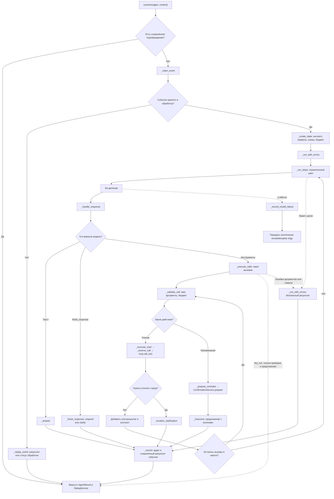

# Маршрут сообщения в AgentService

`DialogService` передаёт историю, настройки и доверенный `EventContext` в `run`.
`AgentService` возвращает `AgentResult`; отправка сообщения в Telegram выполняется обработчиком.

Состояние одного вызова хранится в `_RunState`. Оно не разделяется между пользователями.
`_Outcome` связывает результат с причиной для аудита и признаком сохранения.
Общие правила модели вынесены в `app/prompts/agent.py`; интерфейсы инструментов
`ToolExecutor` и `ToolClient` находятся в `app/core/ports.py`.

После чтения успешный промежуточный вызов записывается в аудит с причиной
`read_succeeded`. Обработанное событие завершается только после итогового ответа,
уточнения, предложения подтверждения или контролируемой ошибки.

Создание напоминания после нажатия кнопки проходит отдельным маршрутом:
`handler → DialogService.confirm_action → ConfirmationService.confirm → MCP`.
Вызов `run` только готовит предложение; он не создаёт напоминание до подтверждения.
В режиме `dry_run` запись и подготовка подтверждения не выполняются.
