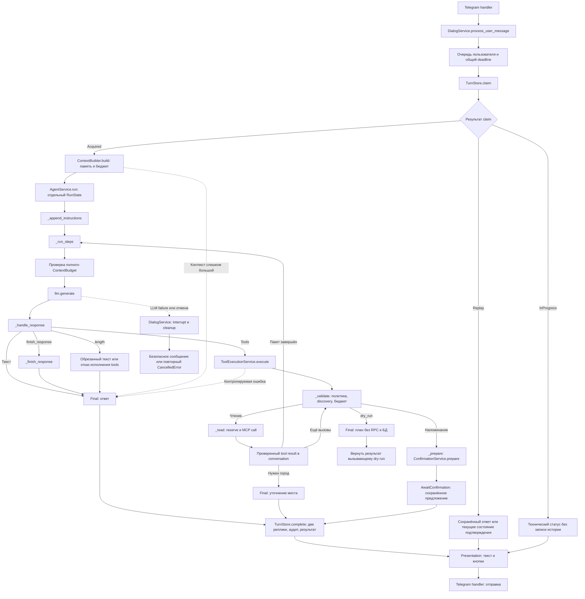

# Маршрут сообщения в AgentService

`DialogService` владеет полным запросом: пользовательской очередью, claim/replay,
общим deadline и атомарным сохранением результата с обеими репликами.
`ContextBuilder` собирает историю, выжимку и проверенный статус последнего действия.
`AgentService.run` получает готовый контекст и выполняет единственный цикл модели.
SQL и Telegram SDK в этом цикле отсутствуют.

`RunState` создаётся на каждый вызов и хранит conversation, доверенный EventContext,
timezone, расход и последний tool call. `Continue`, `Final`, `AwaitConfirmation`
различают переходы. `AgentResult` проверяет наличие confirmation ID у подготовленного
действия; планирование dry run явно помечается `planned`.

Прогноз погоды и уточнение города интерпретируются только для `get_weather`.
Схемы обнаруживаются MCP-клиентом; доверенная локальная политика разрешает два чтения
и подготовку `add_reminder`. Одно событие имеет не более двух фактических MCP-вызовов,
включая подтверждённую мутацию. Бюджет контекста проверяется перед каждым шагом.

После кнопки: `handler → DialogService.confirm_action → пользовательская очередь →
ToolExecutionService.confirm → ConfirmationService.confirm → MCP`. Подтверждение
проверяет владельца, TTL и неизменяемые аргументы. Таймаут или некорректный ответ
после dispatch не доказывает отсутствие эффекта: результат сверяется по idempotency
key сразу и через recovery. Следующий контекст получает статус из confirmation store.

Повтор не запускает компактизацию и не дублирует историю. Ошибка после чтения
закрывает старый запуск как interrupted; новый запрос получает отдельный event key.
При старте одного процесса оставшиеся processing прерываются. Сохранения каждого
LLM/tool шага и гарантированной доставки Telegram через outbox нет.

Форматтеры `app/presentation/agent.py` отвечают за статусы, подтверждения и признак
обрезанного ответа. Диагностические логи чтений содержат request ID, имя инструмента
и длительность конкретного вызова; финальный продуктовый аудит записывается вместе
с результатом события. Сбой вспомогательного аудита ошибки не заменяет её причину.
