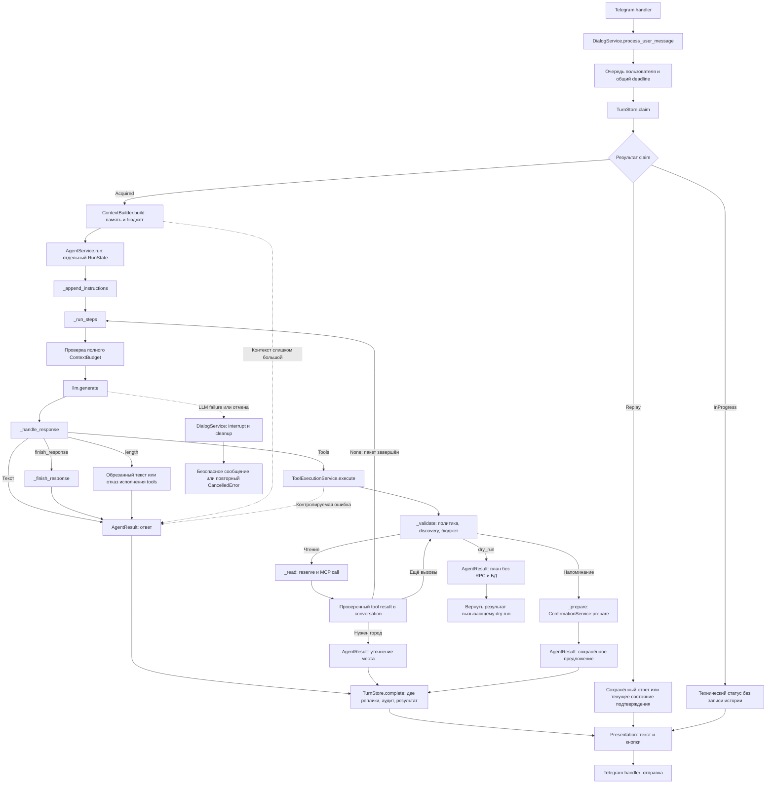

# Маршрут сообщения в AgentService

`DialogService` владеет полным запросом: пользовательской очередью, claim/replay,
общим deadline и атомарным сохранением результата с обеими репликами.
`ContextBuilder` собирает историю, выжимку и проверенный статус последнего действия.
`AgentService.run` получает готовый контекст и выполняет единственный цикл модели.
SQL и Telegram SDK в этом цикле отсутствуют.

При `LLM_STREAMING=true` SSE остаётся внутри `OpenAIClient`: SDK собирает дельты
текста и tool arguments, затем адаптер проверяет завершённый snapshot и возвращает
один `LLMResponse`. Tools не исполняются по фрагментам; незавершённый поток считается
ошибкой, отмена закрывает соединение. Telegram получает только готовый публичный текст.

`RunState` создаётся на каждый вызов и хранит conversation, доверенный EventContext,
timezone, расход и последний tool call. Завершающий шаг возвращает `AgentResult`,
а `None` после чтения запрашивает следующий шаг модели. `AgentResult` проверяет наличие confirmation ID у подготовленного
действия; планирование dry run явно помечается `planned`.

Прогноз погоды и уточнение города интерпретируются только для `get_weather`.
MCP-клиент проверяет разрешённое имя и обнаруженную схему аргументов; ToolExecutionService
отвечает за бюджет, чтения и подготовку `add_reminder`, не дублируя список разрешённых имён.
Одно событие имеет не более двух фактических MCP-вызовов,
включая подтверждённую мутацию. Бюджет контекста проверяется перед каждым шагом;
резерв вывода ограничивается оставшимся местом уже при подготовке первого запроса
и повторно после tool results. Если остаётся менее 64 токенов для генерации,
запрос отклоняется; JSON не обрезается.

Обнаруженный ресурс `schedule://current-week` публикуется модели как `read_resource`
с разрешёнными URI в схеме. `MCPClient.call_tool` направляет его в MCP `read_resource`,
а проверенный JSON недели возвращается обычным tool result. Это один вызов в бюджете.
Для следующей недели используется `get_schedule_week(week_offset=1)`, для недели
с конкретной датой — `get_schedule_week(date)`, для одного дня — `get_schedule(date)`.
Данные содержат `weekday`, `data_available`, `is_free_day` и `free_days`,
чтобы отличать свободный день от отсутствующих данных.
Погода принимает необязательную ISO-дату: `forecast` относится к `requested_date`,
`today` — к текущему дню города. Прогноз и текущие условия не подменяют друг друга.

После кнопки: `handler → DialogService.confirm_action → пользовательская очередь →
ConfirmationService.confirm → MCP`. DialogService получает каталог через ToolClient,
а подтверждения — через ConfirmationService, без зависимости от ToolExecutionService. Подтверждение
проверяет владельца, TTL и неизменяемые аргументы. Таймаут или некорректный ответ
после dispatch не доказывает отсутствие эффекта: результат сверяется по idempotency
key сразу и через recovery. Следующий контекст получает статус из confirmation store.

Инструкция модели различает подготовку и создание: при известных тексте, времени
и зоне, включая точный относительный интервал, модель вызывает `add_reminder`.
ToolExecutionService сохраняет предложение через ConfirmationService и возвращает
его текст и `confirmation_id`; вопрос и кнопки не заменяются текстом самой модели.
Фактический MCP-вызов создания выполняется после подтверждения владельца.

Повтор не запускает компактизацию и не дублирует историю. Ошибка после чтения
закрывает старый запуск как interrupted; новый запрос получает отдельный event key.
При старте одного процесса оставшиеся processing прерываются. Сохранения каждого
LLM/tool шага и гарантированной доставки Telegram через outbox нет.

Форматтеры `app/presentation/agent.py` отвечают за статусы, подтверждения и признак
обрезанного ответа. Диагностические логи чтений содержат request ID, имя инструмента
и длительность конкретного вызова; финальный продуктовый аудит записывается вместе
с результатом события. Сбой вспомогательного аудита ошибки не заменяет её причину.
