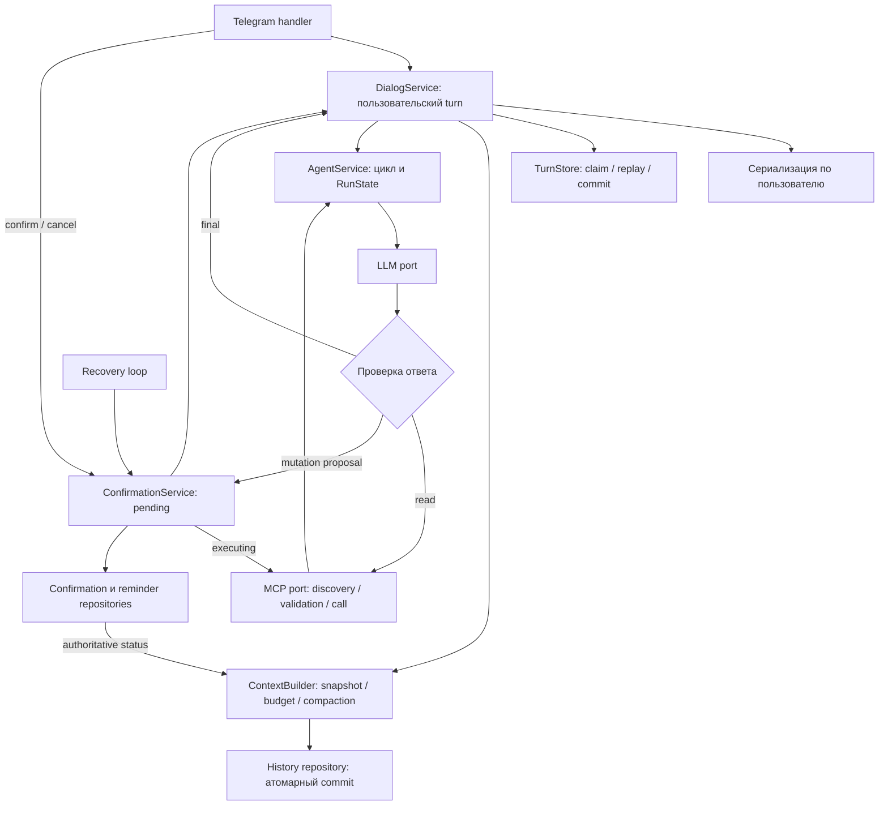

# Независимый аудит DialogService и AgentService

Дата: 26 октября 2026 года. Проверяемый HEAD: `9014d56`. Аудит выполнен по исходному коду и контрактам, без предположения, что текущая декомпозиция правильна. Производственный код и тесты не изменялись.

## Вердикт

Для учебного Telegram-бота выбран разумный масштаб: собственный небольшой цикл агента, три разрешённых MCP-инструмента, явное подтверждение записи, отдельные SDK-адаптеры. Переход на LangGraph, Agents SDK или набор взаимодействующих агентов сейчас не обоснован. `_RunState` уже изолирует состояние отдельных запусков, а `_run_steps` явно ограничивает цикл. Основная проблема — разные части одного пользовательского события сохраняются независимо: результат агента, диалог, summary, подтверждение и аудит. Разбиение длинных методов само по себе эту проблему не исправит.

Есть три приоритетных дефекта согласованности: потеря истории при ошибке сохранения summary; повторная запись диалога при replay; терминальный отказ подтверждения после потенциально успешной мутации. Следом стоит исправить отмену ожидания в очереди и определить семантику повторного запуска после частично выполненных чтений. Остальную декомпозицию следует строить вокруг этих гарантий.

Уровни: **P1** — исправить до доверия к сохранности состояния; **P2** — функциональная надёжность и корректность контракта; **P3** — улучшение структуры. «Доказано» означает воспроизводимость на коде/изолированных двойниках; это не утверждение, что инцидент уже происходил в эксплуатации. Условные риски выделены отдельно.

## Находки по важности

### F1 — P1, доказано: compaction может удалить историю, не сохранив summary

**Места:** `app/services/dialog_service.py:104`, `app/services/dialog_service.py:106`; `app/db/repositories/history_repo.py:92`, `app/db/repositories/history_repo.py:106`, `app/db/repositories/history_repo.py:141`.

`set_dialog_summary` подавляет любое исключение `execute` и возвращает обычный `None`. `compact_history` воспринимает это как успех, удаляет исходные сообщения другим запросом и возвращает `True`. Триггер: INSERT/UPDATE summary завершается ошибкой, а последующее удаление доступно. В изолированном воспроизведении из 10 сообщений осталось 3, summary отсутствовало, результат compaction был `True`.

Даже без подавления исключения запись summary и удаление сообщений не образуют транзакцию: сбой между ними оставляет новую summary вместе с уже включёнными в неё сообщениями. Ошибка чтения предыдущей summary также превращается в `None` (`history_repo.py:81`), поэтому очередное сжатие может перезаписать накопленную память без её старой части. Аналогичное подавление при очистке (`history_repo.py:72`) допускает возвращение старой summary после `/reset`.

**Решение:** один repository-метод `commit_compaction(user_id, expected_revision, source_ids, summary)` с транзакцией записи summary и удаления строго выбранных сообщений; ошибки хранения должны доходить до сервиса. Генерацию выполнять вне SQL-транзакции. Проверять ревизию/границу snapshot при commit, чтобы результат генерации не воскресил историю после reset или конкурентной compaction. `/reset` также должен атомарно удалять сообщения и summary. Если поддержка старой схемы БД нужна, оформлять её явно через миграции, а не `except Exception: pass`.

**Проверки:** ошибка записи summary → исходные сообщения сохранены; ошибка удаления → вся транзакция откатилась; reset во время генерации → устаревшая summary не записана. Последние две гарантии необходимо отдельно проверить на PostgreSQL.

### F2 — P1, доказано: идемпотентность события заканчивается раньше записи истории

**Места:** `app/services/dialog_service.py:118`, `app/services/dialog_service.py:153`, `app/services/dialog_service.py:160`; `app/services/agent_service.py:90`, `app/services/agent_service.py:95`, `app/services/agent_service.py:424`; `app/db/repositories/history_repo.py:8`.

Повторная доставка того же `event_id` получает сохранённый `AgentResult`, но `DialogService` снова вставляет обе реплики. У истории нет уникального ключа события. Воспроизведение двух одинаковых доставок с возвращаемым агентом cached-result дало четыре вызова записи истории. Для события `processing` в историю таким же образом попадает служебное «Этот запрос уже обрабатывается». До проверки replay выполняется даже compaction, то есть повтор может вызвать новый LLM-запрос и изменить память.

Кроме того, `agent_events.result` сохраняется раньше пользовательской и ассистентской реплик, а эти реплики записываются отдельно. Сбой после первой вставки оставляет неполный turn; следующий replay добавит его повторно. Отсутствие `event_id` даёт `local:{get_request_id()}` (`dialog_service.py:150`): при отсутствии request context разные прямые обращения получают один `local:None`.

**Решение:** перенести координацию события на уровень полного turn до подготовки контекста. Возвращать типизированный результат claim: `Acquired`, `Replay`, `InProgress`. `InProgress` — транспортный статус, который не добавляется в память. Завершать turn атомарной записью финального результата и обеих реплик, с уникальностью `(user_id, event_id, message_kind)` либо отдельной таблицей turns. Replay не запускает compaction и не пишет реплики повторно. Внешний event key обязателен для повторяемых доставок; локальному вызову без него выдаётся новый UUID, а не request-id-заглушка.

**Граница гарантии:** это обеспечивает идемпотентность внутреннего состояния. Отправка ответа в Telegram происходит отдельно (`app/handlers/dialog.py:118`) и не становится exactly-once автоматически. Для учебного бота достаточно честно сохранить эту границу; outbox нужен только при явном требовании восстанавливать недоставленные ответы.

### F3 — P1, доказан опасный переход: некорректный ответ мутации принимается за отсутствие эффекта

**Места:** `app/mcp/client.py:286`, `app/mcp/client.py:301`; `app/services/confirmation_service.py:153`, `app/services/confirmation_service.py:180`; `app/db/repositories/confirmation_repo.py:148`, `app/db/repositories/confirmation_repo.py:159`; `app/db/repositories/reminder_repo.py:43`.

MCP-вызов может создать напоминание, после чего клиент отклонит `structuredContent` как `invalid_output`. `ConfirmationService` считает неопределёнными только три кода (`mcp_timeout`, `mcp_unavailable`, `service_unavailable`). `invalid_output` переводит запись в `failed`, а пользователю предлагается новый запрос. Recovery выбирает только `confirmed/executing` и не сверяет такую запись с уже созданным напоминанием. Новый запрос получает новый idempotency key, поэтому пользователь может создать семантический дубль.

Изолированно подтверждено: `ToolFailure('invalid_output', ...)` вызывает `mark_failed`. Возможность ошибки после commit следует из порядка вызова и проверки ответа. Реальная порча ответа после PostgreSQL commit в рамках аудита не инъецировалась. Штатный собственный сервер возвращает валидный DTO; триггер требует сбоя/несовместимости результата или дефекта адаптера.

**Решение:** разделить достоверное отклонение до эффекта и неизвестный исход после dispatch. `invalid_output` после мутации — неизвестный исход. Сначала сверять сохранённый результат по idempotency key; при необходимости оставить `executing/unknown` для recovery. Терминальный `failed` допустим только при доказанном отказе или согласованной политике исчерпания бюджета. Существующее серверное сравнение владельца, подтверждённых аргументов и idempotency key нужно сохранить.

**Проверка:** инструмент фиксирует reminder и возвращает результат, который клиент не может проверить → recovery находит ровно одну запись, подтверждение становится `succeeded`, новый RPC не требуется.

### F4 — P2, доказано: отменённый waiter оставляет пользователя занятым

**Места:** `app/core/queue.py:54`, `app/core/queue.py:60`; использование — `app/handlers/dialog.py:89`, `app/handlers/agent_commands.py:87`.

Счётчик увеличивается до ожидания `user_lock.acquire()`, но `try/finally` начинается после acquire. Если ожидающую задачу отменить, счётчик не уменьшается. После завершения владельца `get_queue_size` в воспроизведении возвращал 1 при отсутствии активных задач. Повторения сокращают доступную очередь вплоть до постоянного `QueueFullError` до перезапуска процесса.

**Решение:** общий `finally` должен снимать регистрацию ожидающего участника независимо от успешности acquire; освобождать lock только если он был захвачен. Не удалять объект lock, пока на него зарегистрированы ожидающие. Проверить отмену до acquire, отмену после acquire, исключение внутри критической секции и следующий нормальный запрос.

### F5 — P2, доказано: retry сохраняет расход, но теряет результаты выполненных чтений

**Места:** `app/services/agent_service.py:99`, `app/services/agent_service.py:321`, `app/services/agent_service.py:383`; `app/db/repositories/event_repo.py:34`; `app/db/migrations/sql/0003_lab2_agent.sql:63`.

После ошибки LLM событие помечается `failed`; при повторе восстанавливается только `calls_used`. Tool calls и их результаты существуют только в `state.conversation`. Например, две успешные операции чтения и timeout на генерации ответа оставляют расход 2. Retry начинает рассуждение заново без полученных данных; повторный tool call блокируется бюджетом. Даже один успешный read может быть выполнен повторно и потратить последний слот. Это защищает предел RPC, но не восстанавливает выполненную работу.

Отмена `CancelledError`, ошибка repository и сбой `_create_state` не проходят через `_record_model_failure`. Событие остаётся `processing`; повтор до истечения 600 секунд отвечает «уже обрабатывается». Автоматический recovery в `app/__main__.py:64` занимается подтверждениями, а не агентскими событиями. `event_repo.begin` не хранит owner/lease generation, `reserve/finish/fail` не проверяют владельца — это дополнительный риск при нескольких процессах и повторном claim устаревшего, но ещё живого запуска, а не доказанный дефект штатного однопроцессного исполнения.

**Решение:** выбрать и закрепить продуктовый контракт retry. Для полноценного продолжения достаточно небольшого checkpoint после каждого успешного read: сообщения с tool-call ID, проверенный результат, шаг, расход, версия схемы/плана. Сохранять результат чтения и продвижение состояния согласованно; неизвестный исход учитывать отдельно. Для более простого варианта явно завершать событие как прерванное и предлагать новое, не изображая восстановление старого. При кооперативной отмене освобождать claim/сохранять прерывание и повторно выбрасывать `CancelledError`. После аварии процесса остаётся lease. Если поддерживаются несколько исполнителей, нужны generation token и условные обновления по нему.

Это применение идеи сохранённых результатов шагов, а не требование внедрить фреймворк. LangGraph документирует replay завершённых task results и необходимость идемпотентности незавершённых операций в своём [Functional API](https://docs.langchain.com/oss/python/langgraph/functional-api#idempotency).

### F6 — P2, доказано: `dry_run=True` не запрещает запись состояния во всех ветках

**Места:** `app/services/agent_service.py:90`, `app/services/agent_service.py:109`, `app/services/agent_service.py:174`, `app/services/agent_service.py:214`, `app/services/agent_service.py:399`.

Dry run пропускает claim и выполнение tool, однако обычный текст/`finish_response`, ошибка validation и `ToolFailure` возвращают `_Outcome` с `persist=True`. При подключённом pool выполняются audit и `event_repo.finish`; ошибка LLM вызывает `event_repo.fail`. При совпадении ключа можно перезаписать уже существующее реальное событие. Воспроизведение plain response с dry run подтвердило audit и finish по одному разу. Текущие dry-run тесты проверяют ветки tools и используют агент без pool, поэтому это не замечают (`tests/test_agent_service_lab2.py:221`, `tests/test_agent_service_lab2.py:403`).

**Решение:** проверять execution mode один раз на границе всех persistence-effects, включая error path. Лучше разделить неизменяющий планирование результат и выполнение, чем переносить флаг `persist` по нескольким внутренним веткам. Явно задокументировать, что dry run всё равно обращается к LLM и расходует его бюджет. Проверки — plain/control/invalid/LLM error при подключённом mock store: ни одной записи.

### F7 — P2, доказан недостаточный контроль: бюджет истории не является бюджетом контекста

**Места:** `app/services/dialog_service.py:61`, `app/services/dialog_service.py:72`, `app/services/dialog_service.py:81`, `app/services/dialog_service.py:145`; `app/services/agent_service.py:194`, `app/services/agent_service.py:331`; `app/db/repositories/history_repo.py:57`, `app/db/repositories/history_repo.py:118`.

`max(history_max_chars, context_length * 0.60 * 2.5)` делает настроенный лимит нижней, а не верхней границей. При context 4096 и настройке 8000 возвращается 8000, хотя вычисленная доля равна 6144. Это арифметический факт; превышение именно token window зависит от модели и текста. Расчёт не включает system prompt, summary, текущий запрос, tool schemas, новые tool results и резерв ответа. `LLMResponse` содержит usage, но run budget его не использует. `get_dialog_history` всегда берёт хотя бы последнее сообщение даже сверх char cap. Compaction читает всю историю и сама может не поместиться в контекст; число сообщений плохо описывает их размер. Ограничение tool calls и LLM steps этого не исправляет.

**Решение:** выделить небольшой `ContextBuilder` с явным `ContextBudget`: ёмкость модели, резерв генерации, оценка фиксированных инструкций/схем/текущего запроса, доступный остаток для памяти. Начать с консервативной оценки, а не обязательного универсального токенизатора. Проверять контекст перед каждым LLM step; ограничивать размер tool output и summary. Compaction обрабатывать ограниченными порциями и сохранять целые turns; вывод суммаризатора ограничить программно, не только просьбой «3–5 предложений». Ввести общий deadline turn и отдельно учитывать LLM steps, RPC attempts и tokens; конкретные лимиты — продуктовый выбор.

Anthropic рассматривает историю, инструкции, инструменты и результаты как единый ограниченный контекст, а compaction — как сохранение нужных фактов с проверкой качества. Это поддерживает выделение такого компонента, но не диктует конкретный токенизатор или процент бюджета: [Effective context engineering for AI agents](https://www.anthropic.com/engineering/effective-context-engineering-for-ai-agents).

### F8 — P2, доказано: агент теряет информацию о незавершённом ответе модели

**Места:** `app/llm/client.py:139`, `app/llm/client.py:163`; `app/services/agent_service.py:208`; для сравнения — `app/services/dialog_service.py:173`.

Адаптер разрешает `finish_reason='length'` с непустым content. В обычном пути DialogService добавляет предупреждение, в основном агентском пути `_handle_response` игнорирует finish reason и сохраняет текст как успешный конечный ответ. Изолированный запуск подтвердил `AgentResult(text='partial', decision='respond')`. Если при `length` присутствует синтаксически валидный tool call, он также доходит до исполнения/подготовки подтверждения.

**Решение:** единая политика завершения LLM step до dispatch: truncated text возвращается с явным признаком незавершённости; вызовы из незавершённой генерации не исполняются без отдельного решения политики. Продолжение ответа, если требуется, расходует тот же бюджет. Проверить normal stop, length с текстом и length с корректным JSON tool call. Не надо переписывать SDK-адаптер: он уже передаёт нужное поле.

### F9 — P2, доказано: исход подтверждения не попадает в память диалога

**Места:** `app/services/dialog_service.py:160`, `app/services/dialog_service.py:251`; `app/handlers/agent_commands.py:87`; `app/services/confirmation_service.py:144`.

В истории сохраняется приглашение подтвердить, но `confirm_action` лишь возвращает результат сервиса. Успех, отказ, отмена и recovery не дописывают статус операции в разговор. Следующая реплика «Ты создал напоминание?» строится по памяти, где виден только вопрос о подтверждении. У агента нет инструмента чтения статуса reminder. Недостаток контекста доказан по пути данных; конкретный ошибочный ответ модели предсказать нельзя.

**Решение:** добавлять в контекст типизированный статус подтверждённого действия из authoritative store или идемпотентно проецировать итог подтверждения в память по confirmation ID. Хранить подготовку и выполненное действие раздельно. Recovery должен обновлять ту же проекцию. Не требуется повторно помещать весь raw tool transcript в долговременную историю.

## Что уже устроено хорошо

- SDK-типы не протекли в проверенные service/handler-контракты: `LLMRequest/LLMResponse`, `ChatMessage`, `ToolClient` изолируют адаптеры. SQL находится в repositories. Собственный прямой цикл здесь соразмерен задаче.
- `_RunState` создаётся на запуск; общая `AgentService` не держит mutable conversation между пользователями. Есть отдельный конкурентный тест (`tests/test_agent_service_lab2.py:430`). Количество шагов модели и вызовов инструментов ограничены раздельно.
- MCP-каталог действительно обнаруживается через `initialize/list_tools`; клиент проверяет входные и выходные JSON Schema, включая formats, и допускает только три известных инструмента (`app/mcp/client.py:60`, `app/mcp/client.py:81`, `app/mcp/client.py:301`). Handler не повторяет MCP-схемы.
- Мутация требует владельца, серверного секрета и сохранённого confirmation ID. Сервер сравнивает именно подтверждённые аргументы и использует уникальный idempotency key под блокировкой строки. Подтверждение не зависит только от обещания в prompt. Есть TTL, отмена, лимит попыток и reconciliation потерянного ответа.
- Summary и tool output не превращаются в system instructions; tool results передаются с соответствующим `tool_call_id`. Проверяется незавершённая генерация summary. Это полезные структурные барьеры, хотя не доказательство невозможности prompt injection.
- OpenAI-адаптер отключает неявные SDK retries, различает timeout/refusal/invalid response, сохраняет usage и finish reason. Логи проверенных путей в основном используют request ID, безопасные коды и счётчики, а не полный prompt или chain-of-thought.

## Умеренная декомпозиция

Не следует делать отдельный класс для каждой ветки `_handle_response` или переносить private-методы без изменения гарантий. Достаточно сохранить три существующих сервиса, выделить сборку контекста и усилить repository-контракты.

| Компонент | Обязанность и граница |
| --- | --- |
| Telegram handlers + форматтеры | Telegram event key, клавиатуры, разметка, typing и доставка. Получают view DTO/доменный результат, не открывают внутренности `agent.mcp` и `agent.confirmations`. |
| `DialogService` | Один пользовательский turn: сериализация, claim/replay, загрузка настроек, вызов ContextBuilder и AgentService, атомарное завершение turn. Отдельные простые методы настроек могут пока остаться здесь. |
| `ContextBuilder` | Snapshot истории, применение роли/summary, оценка бюджета, bounded compaction. Не отправляет Telegram-сообщения и не исполняет business tools. Первоначально это может быть модуль с несколькими функциями и одной структурой бюджета. |
| `AgentService` | Короткий и явный execution loop: построить запрос → проверить ответ → завершить, выполнить read или предложить confirmation. Run state содержит шаг, расход, conversation, last call, deadline; тип результата перехода исключает несовместимые варианты. |
| `ConfirmationService` | Сохранённая машина состояний подтверждённой мутации: prepare/claim/execute/reconcile/cancel. Владелец, TTL и разрешённые переходы — её контракт; истинность самого эффекта проверяет repository/сервер. |
| Repositories / небольшой `TurnStore` | Атомарные claim/commit-turn/commit-compaction, при выбранном durable retry — checkpoint шага. Persistence для аудита отделяется от решения «успех/ошибка операции». Не нужен универсальный ORM repository для каждой таблицы. |
| LLM/MCP adapters | SDK, транспорт, сериализация, discovery и wire validation. MCP-порт возвращает проверенный payload или ошибку с категорией исхода. `ToolPolicy` определяет read/confirmation и разрешения локально, независимо от недоверенных annotations. |

Минимальные контракты полезнее числа классов:

- `ClaimResult = Acquired(lease) | Replay(result) | InProgress` вместо `EventClaim` с несколькими optional-полями.
- `StepOutcome = Continue(tool_results) | Final(reply) | AwaitConfirmation(proposal)`; ошибки имеют безопасный код и категорию `Rejected / RetryableRead / UnknownMutationOutcome`.
- `TurnResult` отделяет пользовательский ответ, pending action, техническое in-progress и truncated response. `AgentResult` сегодня допускает, например, `decision='prepare'` без ID и confirmation ID при обычном ответе (`app/core/schemas/agent.py:14`). Усилить это union-типами или валидатором, не `cast`/подавлением ty.
- `commit_turn` и `commit_compaction` выражают атомарную бизнес-операцию; сервис не собирает её из независимых запросов. `BaseLLMClient.get_context_length` уже объявлен async (`app/llm/base.py:9`), поэтому `getattr/isinstance/iscoroutine` в DialogService следует заменить прямым типизированным вызовом и определённой fallback-политикой.
- Политика инструментов для трёх имён может оставаться обычным словарём/функцией. Не надо копировать input/output schemas из discovery. Нормализация времени и интерпретация неоднозначного города — доменные правила, их разумно держать рядом с конкретным tool policy; `_location_clarification` сейчас определяет погоду только по полю `status` (`agent_service.py:353`), что стоит привязать к имени инструмента.

Состояния run и confirmation нужно описать явно, но они не обязаны становиться одним графовым движком. Например, turn: `claimed → running → awaiting_confirmation/completed/interrupted`; confirmation: `pending → executing → succeeded/failed`, с отдельными `cancelled/expired` до исполнения и неопределённым исходом после dispatch. Предложение не требует возобновлять LLM после подтверждения: для нынешнего сценария детерминированного сообщения об успехе достаточно.

Перенос форматирования из `tools_status/timezone_status/why` (`dialog_service.py:216`, `dialog_service.py:225`, `dialog_service.py:238`) и `ConfirmationService.describe/success` (`confirmation_service.py:33`, `confirmation_service.py:60`) — **P3, структурная рекомендация**, а не причина срочной переписи. Тексты, Markdown и команды принадлежат presentation. Начать можно с небольших typed view DTO и функций форматирования; отдельный service на каждую команду не нужен.

Выбор малого явного цикла согласуется с рекомендацией Anthropic начинать с простых составных решений и добавлять сложность по измеримой необходимости. Статья опубликована в 2024 году и сама отмечает изменение инструментального ландшафта; здесь используется её архитектурный принцип, а не устаревший перечень библиотек: [Building effective agents](https://www.anthropic.com/research/building-effective-agents).

## MCP, ошибки и наблюдаемость: дополнительные ограничения

1. **Discovery корректен для нынешнего собственного статического сервера.** Клиент читает только первую страницу tools/resources и не обновляет каталог по `list_changed` (`app/mcp/client.py:182`). Это условный риск при замене сервера/росте каталога, не доказанный пропуск инструмента сегодня. MCP описывает pagination, уведомления и проверку output schema; при расширении добавить полный snapshot с версией и использовать его согласованно для модели и validation. Локальная политика подтверждения должна оставаться доверенной, annotations сервера не должны выдавать разрешения: [MCP Tools](https://modelcontextprotocol.io/specification/2025-11-25/server/tools).

2. **Ошибки tools сейчас завершают весь turn.** При typo модели это перекладывает исправление на пользователя, хотя подходящим может быть один ограниченный self-correction step с безопасным tool error. Это рекомендация качества, а не обязательная универсальная стратегия. Ошибки прав, подтверждения и неизвестного исхода мутации автоматически перепробовать нельзя. Сначала измерить выигрыш на routing eval; MCP допускает/рекомендует передавать execution errors модели для исправления в [разделе Error Handling](https://modelcontextprotocol.io/specification/2025-11-25/server/tools#error-handling).

3. **Внешние пользователи параллельны на уровне AgentService, но MCP worker глобально последовательный** (`app/mcp/client.py:193`). Медленный weather удерживает другие команды; время в очереди входит в timeout (`app/mcp/client.py:259`). Сама очередь не ограничена. Для малой нагрузки это допустимое упрощение. До увеличения конкурентности нужны измерение задержки и явный предел очереди; затем bounded concurrency с сохранением единственного владельца транспортной сессии. Cancel future не доказывает отмену серверной операции: активный `_execute_command` может ещё закончиться. Именно поэтому неизвестный исход мутации должен сверяться. MCP lifecycle рекомендует request timeout и cancellation notification, но не гарантирует rollback эффекта: [MCP Lifecycle](https://modelcontextprotocol.io/specification/2025-11-25/basic/lifecycle#timeouts).

4. **Аудит влияет на выполнение.** `_record` пишет audit перед event finish (`agent_service.py:409`); `_record_model_failure` может замаскировать исходную LLM-ошибку storage-ошибкой. `_execute_read` уже получил результат, но потеряет его для продолжения, если audit не записался. Нужно решить, является ли audit обязательным журналом бизнес-транзакции или best-effort диагностикой. В первом случае включать его в соответствующий commit; во втором — не менять исход операции из-за сбоя telemetry.

5. **Есть измерения, но их семантика неоднородна.** `read_succeeded.duration_ms` отсчитывается от начала run, а не начала конкретного RPC (`agent_service.py:325`); при error validation теряются `last_call`/arguments (`agent_service.py:183`). Удобнее отдельные безопасные поля `phase`, `step`, `tool`, `outcome`, `attempt`, `queue_ms`, `duration_ms`, `tokens`, `replayed`. Не логировать текст, Telegram ID, raw args или chain-of-thought. `decision_audits` при этом уже сохраняет `user_id/event_id` и до 200 символов reminder text (`app/db/repositories/audit_repo.py:10`): это отдельный персистентный журнал с пользовательскими данными, а не анонимная телеметрия. Требуются явные правила доступа и retention; усечение строки не является обезличиванием.

## Выбираемые блоки работ

Ниже предложения для выбора пользователем. **Ни один блок не реализован в рамках аудита.** Относительный объём: малый / средний / большой в масштабе этого проекта, без оценки в часах. Проверки входят в каждый блок, а не выбираются отдельно. B1–B6 меняют ошибочное или ограниченное поведение; B7 — преимущественно декомпозиция с сохранением наблюдаемого поведения.

| Блок | Цель, границы и ожидаемый результат | Приоритет / объём | Зависимости | Критерии готовности |
| --- | --- | --- | --- | --- |
| **B1. Сохранность памяти** | F1: атомарные compaction/reset, явные ошибки storage, snapshot/revision против устаревшей записи. Summary не теряется вместе с исходными сообщениями. Без нового алгоритма выбора контекста. | P1 / средний | Независим; revision согласовать с B2, если выбраны оба. | Fault injection записи/удаления; reset во время compaction; PostgreSQL rollback и concurrency при `RUN_INTEGRATION=1`; ty/Ruff и релевантные unit-тесты. |
| **B2. Целостный и идемпотентный turn** | F2 и F9: claim до context build, отдельные replay/in-progress, атомарное сохранение пары реплик и результата, стабильный event key, authoritative статус confirmation в следующем контексте. Внешняя доставка Telegram остаётся отдельной гарантией. | P1–P2 / большой | Можно начать отдельно; использует B1 при совместной миграции истории. Статусы unknown должны быть совместимы с B3. | Две доставки → один turn; replay без LLM/compaction; fault injection между result/history; in-progress не попадает в память; callback/recovery отражены один раз; PostgreSQL unique/transaction tests; ty/Ruff. |
| **B3. Достоверный исход подтверждения** | F3: классификация отказа и неизвестного эффекта, reconciliation при invalid output, сохранение владельца/TTL/idempotency. Пользователь не получает ложный отказ после commit. | P1 / средний | Независим; проекция в историю делается в B2. | Commit + invalid output → одна reminder и succeeded после reconciliation; double callback, timeout и exhausted budget; существующие интеграционные сценарии и ty/Ruff. |
| **B4. Безопасное завершение запуска** | F4, F6, F8: cleanup отменённого waiter, отсутствие persistence в dry run во всех ветках, явная обработка truncated response до tool dispatch. Три локальных исправления жизненного цикла без новой durable-модели. | P2 / малый–средний | Независим. При выборе B5 политика отмены run дополнится в нём. | Cancellation до/после acquire без утечек; dry run plain/control/error с mock store без записей; length с текстом и tool calls; ty/Ruff и unit-тесты. |
| **B5. Повтор после частичного выполнения** | F5: выбрать retry-контракт. Умеренный durable-вариант хранит проверенные read results/checkpoint и восстанавливает их без повторного RPC; простой вариант явно прерывает старый run. Ownership/lease только в требуемом масштабе исполнителей. | P2 / средний–большой | Желателен B2; до реализации требуется выбор retry и числа workers. | Успешный read → LLM timeout → выбранное поведение retry; общий budget не сбрасывается; cancellation/аварийный lease; при multi-worker — stale owner не завершает новый run; ty/Ruff и соответствующие SQL-тесты. |
| **B6. Контекст и расход ресурсов** | F7: ContextBuilder, общий context budget, ограниченная compaction, резерв вывода, проверка tool output и deadline turn. Сохраняются режимы и правила недоверенных данных. | P2 / средний | B1 рекомендован до изменения compaction; желателен B4 для корректного truncated outcome. Нужны продуктовые лимиты. | Маленькое окно, длинные summary/сообщения/output, compaction порциями; фиксированные примеры на сохранность фактов и число вызовов; deadline; ty/Ruff и unit-тесты. |
| **B7. Ясные границы сервисов и контрактов** | Typed outcomes/ports, короткий execution loop, локальная tool policy, DTO для статусов, форматирование у presentation, отказ от duck typing. Без внедрения фреймворка, новых стратегий retry и новых инструментов. | P3 / средний | Лучше после выбранных B1–B6; возможно отдельно, но не устраняет их дефекты. | Characterization tests сохраняют пользовательские тексты/кнопки и routing; state transitions проверяются без SDK/БД; ty без подавлений, Ruff и релевантные unit-тесты. |

Рекомендуемый минимум для сохранности состояния — **B1 + B2 + B3**; B4 — компактное дополнение по надёжности. B5 и B6 зависят от желаемого поведения и лимитов. B7 полезен для дальнейшего развития, но не должен задерживать P1-исправления. Улучшение MCP pagination/concurrency и расширенная телеметрия из предыдущего раздела остаются отдельным резервом, пока нет соответствующего требования; они не включены неявно ни в один блок.

## Миграция с сохранением поведения

1. **Зафиксировать дефекты проверками, затем исправить атомарность истории.** Сохранить существующие режимы, тексты и happy path; добавить failure injection для F1, F2 и отмены очереди F4. Ввести transactional commit compaction/reset и идемпотентную запись turn. Миграция добавляет ключи для новых событий; старые строки остаются читаемыми. PostgreSQL проверки транзакций/unique constraints запускать отдельно только при `RUN_INTEGRATION=1`.
2. **Уточнить исходы подтверждения.** Разделить отказ и неизвестный исход, исправить F3, сохранить текущие owner/TTL/argument/idempotency checks. Добавить сценарий commit + invalid response, повторный callback, timeout после commit и исчерпание бюджета. Последний сценарий уже частично покрыт интеграционными тестами; расширять их по изменённой гарантии.
3. **Укрепить границу полного события.** Claim до context build; distinct replay/in-progress; обязательная стратегия event key; атомарный terminal commit. Прикладная сериализация принадлежит сервисному entrypoint, а обработчик может подписываться на состояние очереди для UI. Не удерживать SQL-транзакцию во время LLM/MCP. Проверить duplicate delivery, сбой между агентом и history commit, параллельный reset и direct service callers.
4. **Зафиксировать контракты выполнения.** Исправить dry run и finish reason без переноса всех классов; ввести типы переходов и outcome certainty. Выбрать retry из F5. Если нужен resume, сохранять ограниченный checkpoint после read и проверять timeout следующей генерации без повторного RPC. Если нужен только новый turn, явно тестировать этот UX. Добавить cancellation tests и условные lease checks для выбранного числа workers.
5. **Выделить ContextBuilder и бюджет.** Сначала воспроизвести текущую сборку prompt как characterization tests, затем проверить маленький context, длинную summary, большое последнее сообщение, крупный tool output и compaction нескольких порций. Измерять количество LLM-вызовов и сохранность важных фактов на фиксированных примерах; byte-for-byte сохранение модельной summary не требуется.
6. **Упростить presentation и зависимости.** Возвращать DTO статусов, форматировать в handlers/formatters, скрыть публичный доступ к `agent.mcp/confirmations`, убрать duck typing для объявленных портов. Сохранить те же клавиатуры и команды. Не создавать интерфейсы без реальной второй реализации или необходимости изолировать side effect.
7. **Проверить итог.** `uv run --locked ty check`, Ruff lint/format, изолированный pytest, затем санкционированный `RUN_INTEGRATION=1` для миграций и конкуренции БД. Routing eval на поддельной модели — регрессия orchestration; качество реальной LLM требует отдельной явной авторизации. Не расширять task сетевыми вызовами автоматически.

## Вопросы, требующие продуктового решения

- Retry должен продолжать исходный run, повторно отвечать по сохранённым данным или создавать новый turn? От этого зависят checkpoints, расход бюджета и срок хранения tool results.
- Нужно ли автоматически сообщать пользователю об успехе после recovery? Сейчас обновляется БД, но без нового callback пользователь не получает уведомление. Это отдельное требование доставки; аудит не отправлял сообщений.
- Должны ли `/reset`, смена режима и смена timezone отменять старое pending confirmation? Сейчас reset чистит только диалог, а подтверждение хранит прежние аргументы и timezone. Это может быть корректно, но должно соответствовать тексту команд и ожиданиям пользователя.
- Допустимо ли при новом reminder молча отменять предыдущее pending (`confirmation_repo.py:57`), и нужно ли сохранять продолжение сложного запроса после подтверждения? Сейчас первый `add_reminder` завершает batch (`agent_service.py:264`), последующие calls не исполняются; для сценария «одно напоминание за раз» это допустимая политика, для составной задачи — неполный workflow.
- Бот остаётся однопроцессным или планируется несколько workers? Локальная очередь обеспечивает порядок только внутри процесса; полноценная межпроцессная сериализация должна появиться по требованию, а не ради абстрактной масштабируемости.
- Что означает правило «не записывать пользовательский текст/Telegram ID в логи» применительно к `decision_audits`, нужному для `/why`? Нужна явная граница между продуктовым хранилищем, аудитом и диагностическими логами, а также срок удаления истории, events, confirmations и audits.
- Каковы приемлемые задержка, стоимость и длина ответа? Без этого нельзя честно выбрать total deadline, output reserve, порог compaction и количество self-correction steps.

## Что реально проверено и что не проверено

Прочитаны AGENTS.md, оба основных сервиса, ConfirmationService, связанные handlers, порты/DTO, LLM/MCP adapters, MCP server, repositories истории/событий/подтверждений/напоминаний/аудита, настройки и lifecycle, релевантные unit- и PostgreSQL-тесты. Сверены официальные источники Anthropic, LangGraph и MCP по прямым ссылкам выше; рекомендации фреймворка не выданы за универсальный стандарт. Старый URL LangGraph `durable-execution` на момент проверки перенаправляет на persistence, поэтому для семантики replay использована актуальная документация Functional API.

Выполнено:

- `uv run --locked ty check` — успешно.
- `uv run --locked ruff check app/services app/core/ports.py app/core/queue.py app/db/repositories app/mcp app/llm tests/test_agent_service_lab2.py tests/test_compaction_and_context.py tests/test_queue.py` — успешно.
- `uv run --locked pytest -q tests/test_agent_service_lab2.py tests/test_compaction_and_context.py tests/test_queue.py tests/test_mcp_client_lab2.py tests/test_llm_sdk.py tests/test_agent_commands.py tests/test_storage.py` — **84 passed, 2 skipped**.
- `uv run --locked pytest -q tests/test_bot_scenarios.py` — **15 passed**. Итого выбранные тесты: **99 passed, 2 skipped**.
- `uv run --locked ruff format --check app/services/dialog_service.py app/services/agent_service.py app/services/confirmation_service.py app/core/ports.py app/core/queue.py app/db/repositories app/mcp app/llm` — **17 files already formatted**.
- Изолированные однократные Python-проверки с `AsyncMock`, fake SQL connection и существующим InMemoryPool: отмена waiter; повторная запись turn; подавление ошибки summary; полная compaction с удалением 7 сообщений без сохранённой summary; dry run при подключённом pool; truncated response; переход `invalid_output → failed`. Скрипты не добавлялись в репозиторий.

Не читался `.env`; не выполнялись реальные LLM/Telegram/MCP RPC, не отправлялись сообщения и не поднимался PostgreSQL/Docker. SQL-конкурентность, recovery при настоящем commit и гарантии миграций изучены по коду и имеющимся тестам, но не перепроверены интеграционно. Успешные unit-тесты не доказывают отсутствие найденных дефектов: для нескольких путей в них отсутствует fault injection, а InMemoryPool не воспроизводит транзакции PostgreSQL.
