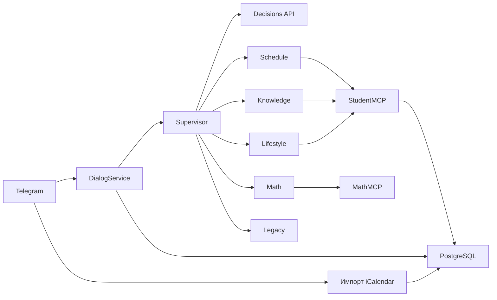
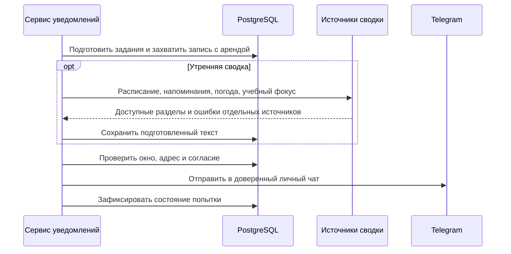

# Архитектура Lab 3

DialogService управляет очередью владельца, повтором результата и общим
дедлайном. Решение Router помогает выбрать исполнителя. Supervisor ограничивает
меню специалиста по текущему MCP discovery. Перед вызовом приложение проверяет
весь пакет инструментов. Student MCP получает владельца календаря и разрешение
веб-поиска в метаданных клиента. Подтверждение напоминания привязано к сохранённому
действию и владельцу.

Миграции разделяют личные календари, настройки и очередь уведомлений, технические
трассы. Идемпотентный ключ защищает создание задания. Сбой после ответа Telegram
и до записи результата оставляет возможность повторной доставки.
