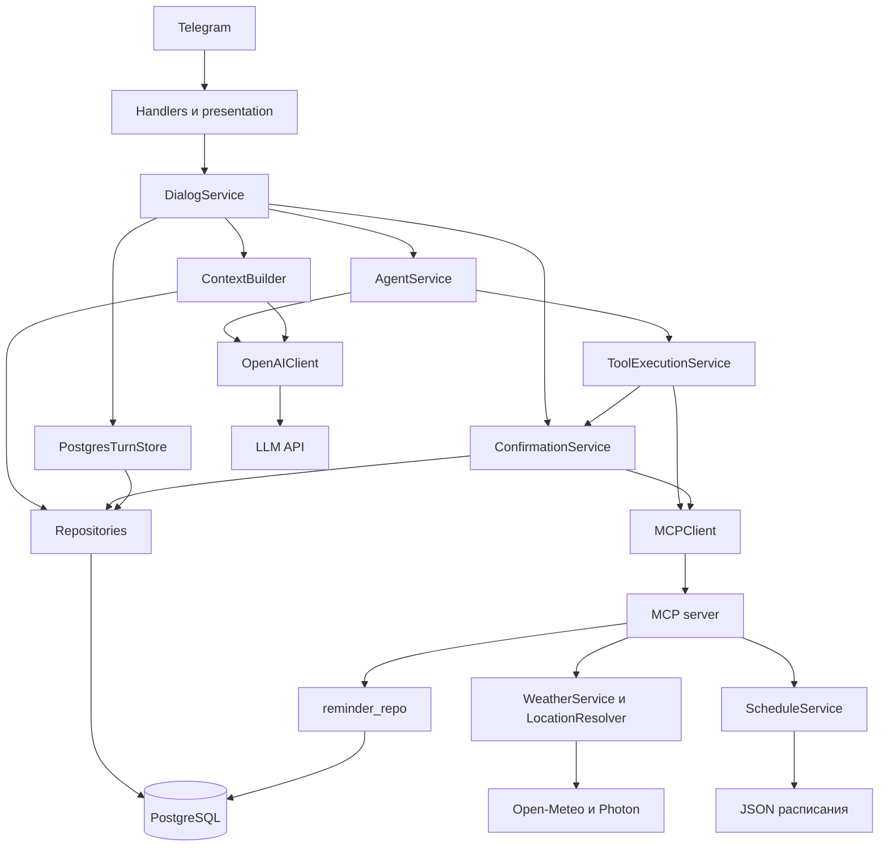
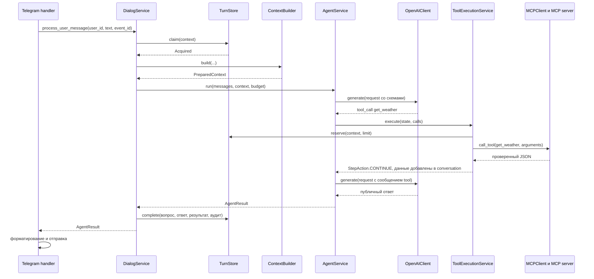
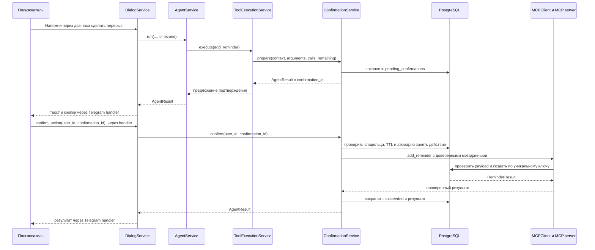

# Архитектура и путеводитель по кодовой базе

Документ описывает текущую реализацию бота и предназначен для чтения кода
и подготовки к защите lab2. Команды запуска находятся в [README](../../README.md),
контракт — в [спецификации](../../spec.md), результаты проверок —
в [отчёте lab2](../report-lab2.md). Подробный граф методов агентного цикла вынесен
в [маршрут AgentService](agent-service.md).

## 1. Что представляет собой приложение

Бот принимает сообщения Telegram, собирает контекст разговора и обращается
к языковой модели. Модель может ответить, запросить уточнение или предложить
вызов инструмента. Приложение проверяет это решение и управляет исполнением.
Доступ к погоде, расписанию и созданию напоминаний предоставлен собственным
MCP-сервером.

Сервисные классы `DialogService`, `AgentService` и остальные — объекты Python
в процессе бота. MCP-сервер запускается дочерним процессом при `stdio`
или отдельным сервисом при Streamable HTTP. Для хранения используется PostgreSQL,
для генерации — внешний OpenAI-совместимый API, в том числе OpenRouter или Ollama.

### Границы компонентов

| Компонент | Где находится | Ответственность |
| --- | --- | --- |
| Запуск и связывание объектов | [app/__main__.py](../../app/__main__.py) | Настройки, подключения, создание сервисов, polling, восстановление и завершение |
| Telegram-обработчики | [app/handlers/](../../app/handlers/) | Чтение сообщений и callback, команды, кнопки, отправка ответа |
| Представление | [app/presentation/agent.py](../../app/presentation/agent.py), [core/formatters.py](../../app/core/formatters.py) | Тексты статусов, форматирование и разбиение длинных ответов |
| Сервисы приложения | [app/services/](../../app/services/) | Пользовательские сценарии, память, агентный цикл и подтверждения |
| Контракты и общие механизмы | [app/core/](../../app/core/) | Типы сообщений, результаты, бюджеты, очередь, часы и ошибки |
| LLM-адаптер | [app/llm/](../../app/llm/) | OpenAI SDK, сборка запросов, streaming, разбор ответа и диагностика |
| MCP-клиент | [app/mcp/client.py](../../app/mcp/client.py) | Discovery, проверка схем, транспорт и вызовы MCP |
| MCP-сервер | [mcp_servers/student_tools/](../../mcp_servers/student_tools/) | FastMCP-сервер `student-tools`: погода, расписание и подтверждённое создание напоминаний |
| Репозитории и миграции | [app/db/](../../app/db/) | SQL, транзакции, ограничения уникальности и схема PostgreSQL |
| Режимы и инструкции | [app/modes/](../../app/modes/), [app/prompts/](../../app/prompts/) | Учебный режим, перевод, ревью, примеры и правила работы агента |

SQL сценариев хранения сосредоточен в репозиториях. Типы OpenAI SDK ограничены LLM-адаптером,
типы FastMCP Client / server SDK — клиентом и сервером MCP. Сервисы работают с собственными DTO
и контрактами приложения.

### Основные связи

Стрелка означает обращение к компоненту, а не отдельный сетевой сервис.

`DialogService` получает каталог через `ToolClient` и обращается за подтверждениями
непосредственно к `ConfirmationService`. Он не зависит от `ToolExecutionService`.
Исполнение инструментальных решений модели принадлежит `AgentService`
и `ToolExecutionService`.

## 2. Запуск приложения

В [app/__main__.py](../../app/__main__.py) находится место сборки зависимостей:

1. `main()` читает `Settings.load()`, настраивает логирование и запускает `run()`.
2. `run()` создаёт LLM-клиент и пул PostgreSQL; `create_pool()` применяет миграции.
3. `_prepare_telegram()` проверяет Telegram и отсутствие webhook, задаёт команды
   и описание бота.
4. `create_student_tools_client(settings)` из [mcp/connection.py](../../app/mcp/connection.py)
   собирает FastMCP Client с настроенным stdio или HTTP transport, секретом и
   SDK timeout/init timeout; `MCPClient.start()` выполняет discovery внутри
   SDK-контекста операции.
5. Создаются `ConfirmationService`, `PostgresTurnStore`, `ToolExecutionService`,
   `AgentService` и `DialogService`. Общие экземпляры передаются в конструкторы.
6. `DialogService.recover()` прерывает оставшиеся незавершённые события прошлого
   запуска. Фоновая `_recover_services()` каждые 15 секунд сверяет подтверждения
   и повторяет discovery, если каталог помечен недоступным.
7. Запускаются локальный `/health` и Telegram polling. `DialogService` передаётся
   обработчикам через механизм зависимостей aiogram.

`_shutdown()` отменяет фоновые задачи и закрывает MCP, HTTP-сервер, LLM-клиент,
Telegram-сессию и пул БД. `AsyncExitStack` обеспечивает выполнение зарегистрированных
операций очистки даже при ошибке одной из них.

## 3. Основные сервисы и методы

### DialogService: весь пользовательский запрос

Файл: [dialog_service.py](../../app/services/dialog_service.py).

Этот сервис связывает очередь, повторную доставку, настройки пользователя,
подготовку контекста, запуск агента и итоговое сохранение.

| Метод | Что делает |
| --- | --- |
| `process_user_message()` | Создаёт доверенный `EventContext`, получает очередь пользователя, устанавливает общий deadline и проверяет событие через `TurnStore.claim()` |
| `_process()` | Использует уже подготовленное действие либо запускает агента; сохраняет результат, обе реплики и аудит через `TurnStore.complete()` |
| `_run_agent()` | Читает режим, температуру и зону пользователя; получает статус последнего действия; вызывает `ContextBuilder.build()` и затем `AgentService.run()` |
| `_interrupt()` | Фиксирует прерывание; сбой вспомогательной очистки не заменяет исходную ошибку |
| `confirm_action()` | Под очередью пользователя передаёт подтверждение или отмену в `ConfirmationService.confirm()` |
| `tools_status()` | Возвращает обнаруженный каталог для `/tools`, помечая инструмент изменения |
| `timezone_status()` | Показывает используемую IANA-зону для `/timezone` либо сохраняет явный выбор; без настройки применяется `Europe/Moscow` |
| `why()` | Получает последнюю запись аудита пользователя для `/why` |
| `switch_mode()`, `reset_history()`, `set_temperature()` | Выполняют изменение пользовательских настроек и истории под очередью |
| `compact_history()`, `recover()` | Запускают ручную компактизацию и восстановление событий соответственно |

Повтор с готовым результатом возвращается до подготовки контекста и вызова LLM.
Если исходное событие содержит предложение напоминания, сервис обновляет его ответ
по текущему состоянию подтверждения: например, показывает уже выполненное действие.

Эффективную зону выбирает приложение: явно сохранённая IANA-зона пользователя
имеет приоритет, при `NULL` используется `Europe/Moscow`. Та же зона передаётся
в инструкции модели и показывается командой `/timezone`; чтение значения
по умолчанию не перезаписывает настройки пользователя в БД.

#### Claim, replay и обработка очереди

`process_user_message()` получает очередь пользователя, задаёт общий deadline и
вызывает `TurnStore.claim()`. `Replay` возвращает сохранённый итог без LLM; если
это было предложение напоминания, сервис перечитывает его актуальное состояние.
`InProgress` возвращает технический статус без новой реплики в истории. Для
`Acquired` обработка запускается с сохранённым расходом MCP-вызовов. Очередь
освобождается и при обычном возврате, и при исключении; прерывание фиксируется,
пока запрос ещё владеет очередью.

### ContextBuilder: память и размер запроса

Файл: [context_builder.py](../../app/services/context_builder.py).

Результат `build()` — `PreparedContext`: сообщения для модели и `ContextBudget`.
Текущий пользовательский текст сохраняется в историю позднее, вместе с ответом.

| Метод | Что делает |
| --- | --- |
| `budget()` | Получает размер окна модели; при недоступных метаданных использует настройку приложения. Ограничивает исходный резерв ответа половиной окна |
| `build()` | Проверяет необходимость компактизации; собирает режим, выбранный пример, summary, статус действия, историю и текущий запрос |
| `complete_pairs()` | Выделяет завершённые пары `user → assistant`, пропуская одиночные сообщения |
| `_fit_context()` | Считает обязательную часть вместе со схемами и инструкцией; оставляет свежую историю полными парами с минимумом 64 токена для ответа, затем выделяет генерации оставшееся место в пределах заданного максимума |
| `compact()` | Выбирает старые пары для summary, сохраняет новую выжимку и удаляет выбранные сообщения одной транзакцией |
| `_select_compaction_input()` | Подбирает помещающиеся пары вместе с их исходными ID, чтобы удалить именно выбранные записи |
| `_summarize()` | Вызывает LLM для выжимки и проверяет длину, завершённость и отсутствие tool calls |

Здесь возможен отдельный вызов `llm.generate()` для сжатия истории.
Он не выполняет пользовательское действие и не запускает второй агентный цикл.
При ошибке сжатия старые сообщения не удаляются; подбор контекста всё равно
ограничивает передаваемую модели историю.

### AgentService: обычный цикл tool calling

Файл: [agent_service.py](../../app/services/agent_service.py).

Модель получает один обычный tool-calling request: обнаруженные MCP tools и две
локальные функции приложения — `read_resource(uri)` и `clarification(question)`.
`AgentService` определяет обе локальные функции; для `read_resource` он строит URI
enum из каталога `list_resources`. Модель выбирает URI в том же запросе, где
решает, вызвать ли MCP tool.

| Метод или свойство | Что делает |
| --- | --- |
| `_resource_reader_definition()` | Строит схему локальной функции из `ReadResourceArguments` и обнаруженных URI |
| `definitions` | Объединяет discovery MCP tools с локальными `read_resource(uri)` и `clarification(question)`; проверяет конфликты имён |
| `instructions()` | Строит правила с текущим временем, календарём, пользовательской зоной и доступностью MCP |
| `run()` | Создаёт `RunState`, добавляет правила и запускает общий цикл LLM |
| `_run_steps()` | Проверяет полный контекст, вызывает `llm.generate()` и соблюдает общий предел в четыре шага |
| `_handle_response()` | Обрабатывает обычный текст, локальное уточнение и tool calls; обычный текст завершает цикл |
| `_clarify()` | Проверяет единственный вызов `clarification` и возвращает `AgentResult(CLARIFY)` без MCP |

Когда модель вызывает локальный `read_resource(uri)`, вызов проходит общую
проверку всего tool-call batch до первого RPC. `ToolExecutionService` проверяет
URI по discovery, резервирует один вызов и читает ресурс через
`MCPClient.read_resource()`. Содержимое помещается в conversation как
сообщение роли `tool` с исходным `tool_call_id` и JSON-обёрткой `source`, URI,
`mime_type`, `content`. Это недоверенные данные. Ошибка чтения возвращается
модели как tool error content, чтобы обычный следующий шаг мог уточнить запрос
или ответить с доступными данными. Эта политика относится к ошибке resource RPC;
ошибки нативных MCP tools и проверки до RPC остаются терминальными.

`read_resource` — локальный host adapter. MCP-сервер публикует resource в
`list_resources`, но не публикует эту функцию в `list_tools`; клиентский host
перехватывает её и вызывает протокольный `resources/read`, а не `tools/call`.
Успешно прочитанные URI сохраняются в `RunState.resource_uris` и возвращаются
в `AgentResult.resource_uris`, в том числе при последующем ответе, tool read или
подготовленном действии.

Локальный `clarification(question)` превращается в `AgentResult(CLARIFY)` без
сети. После успешного native MCP tool read или успешного/ошибочного resource RPC
`ToolExecutionService` возвращает `StepAction.CONTINUE`, и `AgentService` делает
следующий шаг модели. Ошибки нативных MCP tools, валидации аргументов и проверки
бюджета завершают цикл через `ToolFailure`.

### ToolExecutionService: политика исполнения

Файл: [tool_execution.py](../../app/services/tool_execution.py).

| Метод | Что делает |
| --- | --- |
| `execute()` | Проверяет пакет discovery-вызовов; выполняет чтения либо готовит разрешённое напоминание |
| `_validate_batch()` | Валидирует обнаруженные схемы; допускает только `add_reminder` как изменение и не разрешает несколько мутаций |
| `_reserve()` | Резервирует MCP-вызов в хранилище события и увеличивает счётчик `RunState` |
| `_read()` | Вызывает MCP tool, ограничивает размер JSON-ответа и добавляет его в conversation как сообщение tool |
| `_read_resource_call()` | Читает ресурс через `MCPClient`, ограничивает содержимое и добавляет success/error tool message с исходным call ID |
| `_prepare()` | Передаёт аргументы напоминания в `ConfirmationService.prepare()` с `position=0` и остатком бюджета |

`ToolExecutionService` не хранит часы и не нормализует время. Проверка и нормализация
аргументов напоминания выполняются в `ConfirmationService` с его часами и выбранной
зоной пользователя. Позиция предложения фиксирована на нуле: за одно событие
разрешена одна подтверждаемая мутация, а прежние записи БД с другими позициями
остаются читаемыми.

### ConfirmationService: подтверждение и восстановление изменения

Файл: [confirmation_service.py](../../app/services/confirmation_service.py).

| Метод | Что делает |
| --- | --- |
| `prepare()` | Нормализует время и сохраняет неизменяемое предложение с владельцем, TTL, позицией вызова и остатком бюджета |
| `existing()` | Возвращает актуальный результат уже подготовленного действия для исходного события |
| `confirm()` | Атомарно проверяет владельца и состояние; подтверждает, отменяет или возвращает существующий результат |
| `_execute()` | Выполняет реальный MCP-вызов `add_reminder` с доверенными владельцем и ID подтверждения; проверяет и сохраняет результат |
| `_recover_committed()` | Ищет уже созданное напоминание по ключу идемпотентности, если ответ был потерян |
| `recover()` | Сверяет зависшие действия и при допустимых условиях возобновляет исполнение с тем же ключом и остатком бюджета |
| `action_context()` | Формирует сообщение о последнем состоянии действия из БД для следующего обращения к модели |
| `_audit()` | Записывает ограниченные сведения об исходе подтверждения |

Новое предложение отменяет предыдущее ожидающее предложение того же пользователя.
Повтор подготовки с теми же событием и позицией возвращает существующую запись
и не продлевает TTL.

## 4. Адаптеры LLM и MCP

### OpenAIClient

Файл: [llm/client.py](../../app/llm/client.py).

| Метод | Что делает |
| --- | --- |
| `generate()` | Общая точка генерации; пишет безопасные диагностические события с моделью, длительностью и кодом ошибки |
| `_generate()` | Применяет тайм-аут и выбирает обычный запрос либо streaming; переводит ошибки SDK в ошибки приложения |
| `_stream_response()` | Дожидается завершения SSE-потока и получает собранный SDK snapshot |
| `get_context_length()` | Получает размер окна через `ContextLengthResolver`, который кэширует метаданные и использует запасное значение при ошибке |

Преобразование DTO находится отдельно в [codec.py](../../app/llm/codec.py):
`encode_request()` собирает payload, `decode_response()` преобразует проверенный
SDK completion, `decode_stream_response()` нормализует несовместимые роли и
проверяет собранный streaming snapshot, `decode_tool_arguments()` разбирает JSON
аргументов. Обычный ответ проверяет SDK с включённой строгой валидацией, в том
числе когда `AsyncOpenAI` передан извне; цикл ручного dump и повторной проверки
для этого пути не нужен. Для streaming строгая SDK-проверка отключена из-за
вариантов ролей у провайдеров, затем codec нормализует их и валидирует snapshot.
Проверки JSON Schema форматов и конечности чисел остаются в кодеке аргументов и
каталоге инструментов там, где проверка SDK их не покрывает.

Streaming заканчивается внутри адаптера. Telegram получает готовый публичный ответ;
инструменты не исполняются по незавершённым фрагментам аргументов. При `length`
незавершённый tool call не исполняется, а обрезанный текст помечается явно.
Для streaming `decode_stream_response()` сначала нормализует отсутствующие и
повторные `assistant` roles в SDK snapshot, затем проверяет его как
`ChatCompletion` и преобразует в `LLMResponse`.

### MCPClient

Файл: [mcp/client.py](../../app/mcp/client.py).

| Метод | Что делает |
| --- | --- |
| `__init__(client, secret)` | Принимает уже сконфигурированный FastMCP Client и секрет для trusted metadata |
| `start()` | Загружает tools и resources внутри SDK-контекста операции; обновляет признак доступности каталога |
| `_request()` | Открывает `async with self._client` на операцию; переводит ошибки SDK и native MCP timeout `-32001` в безопасные `ToolFailure` |
| `load_catalog()` | Передаёт discovery tools в `ToolCatalog` и обновляет публичную карту definitions |
| `load_resources()` | Сохраняет обнаруженные ресурсы как нейтральные `ResourceDefinition`; каталог только с ресурсами тоже считается доступным |
| `call_tool()` | Проверяет аргументы и доступ к мутации, вызывает RPC один раз и валидирует результат через каталог |
| `read_resource()` | Читает URI напрямую через FastMCP Client и возвращает нейтральный `ResourceContent` |
| `aclose()` | При остановке приложения сбрасывает доступность и вызывает штатный `Client.close()` |

После неудачной инициализации SDK может повторно выбросить сохранённую ошибку
при `close()`. В этом случае адаптер явно закрывает транспорт, чтобы завершить
сохранённый stdio-процесс. Тип ошибки записывается в лог без её содержимого.

Схемы и валидаторы сосредоточены в [catalog.py](../../app/mcp/catalog.py).
`ToolCatalog` хранит одну неизменяемую запись `DiscoveredTool` на имя инструмента:
definition, `readOnlyHint` и скомпилированные валидаторы входа/выхода. `MCPClient`
сохраняет публичные карты `tools` и `resources` для своих портов, а не поддерживает
четыре параллельные карты со схемами и политикой.

Каждая операция использует `async with self._client`. Вложенные и параллельные
операции совместно используют SDK-сессию; библиотека освобождает её после выхода
последней операции. Timeout отдельного RPC не сбрасывает
`available` и не прерывает другие запросы. Для stdio `keep_alive=True` сохраняет
серверный процесс между контекстами; HTTP создаёт SDK-сессию для каждой
последовательной операции. `available` означает, что discovery загрузил tools или
resources, а не что сокет постоянно открыт.

Создание транспорта и SDK-настройки принадлежат
`create_student_tools_client(settings)` в [connection.py](../../app/mcp/connection.py),
а `MCPClient` получает готовый `Client` и не выбирает transport. Фоновая
`_recover_services()` в `app/__main__.py` раз в 15 секунд повторно запускает
discovery только если каталог недоступен. Cancellation освобождает контекст
операции, не закрывая сессию других запросов. Ошибки SDK преобразуются в безопасные
`ToolFailure`; значения для известных кодов погоды и расписания заданы в самой
модели `ToolFailure`. RPC не переигрывается автоматически.

### MCP-сервер и источники данных

В [server.py](../../mcp_servers/student_tools/server.py) `build_server()` создаёт
FastMCP сервер с именем `student-tools`; CLI и HTTP-приложение находятся в
[__main__.py](../../mcp_servers/student_tools/__main__.py). Сервер discovery-ом
публикует четыре инструмента и ресурс `schedule://current-week`. В Compose сервис
называется `student-tools-mcp`, и приложение подключается к нему по этому DNS-имени.
Сервер запускается отдельным процессом, но не является автономным Python-пакетом:
он импортирует общие контракты и часы из `app.core`, транспорт из `app.config`,
настройки приложения и репозитории из `app.db`. Поэтому DTO, проверки и правила
хранения не дублируются; развёртывание включает приложение и серверный пакет в
одном Python-проекте.

| Возможность | Реализация и поведение |
| --- | --- |
| `get_weather(city?, date?)` | `WeatherService.get_weather()` → `LocationResolver.resolve()` → погодный API. По умолчанию Санкт-Петербург и сегодня в зоне города; помечен `readOnlyHint=true` |
| `get_schedule(date?)` | `ScheduleService.get_schedule()` читает день из JSON; без даты используется сегодня в `SCHEDULE_TIMEZONE`; read-only |
| `get_schedule_week(date?, week_offset=0)` | `week_containing()` или `relative_week()` собирает неделю по одному снимку файла; read-only |
| `add_reminder(text, remind_at)` | Проверяет `Context` metadata и сохранённое подтверждение, затем вызывает `reminder_repo.create_confirmed_reminder()`; помечен как изменяющий |
| `schedule://current-week` | `ScheduleService.current_week()` отдаёт текущую календарную неделю через native MCP resource API |

Ресурсы не становятся MCP tools: `list_tools` содержит только четыре серверных
инструмента, а ресурсы перечислены отдельно через `list_resources`. При этом host
добавляет модели локальную функцию `read_resource(uri)` с URI enum, динамически
построенным из discovery, и перехватывает её вызов для протокольного resource RPC.
Функция не отправляется MCP-серверу через `tools/call`.
Выходные JSON Schema discovery описывают успешные значения; серверный `ToolError`
содержит безопасное JSON-сообщение ошибки, которое клиент преобразует в `ToolFailure`.
Resource errors возвращаются host как tool error content с исходным call ID, без
автоматического повтора RPC.

`WeatherService` разделяет текущие условия и дневной прогноз: `today` описывает
сегодняшний день города, `forecast` относится к `requested_date`. Для будущей даты
текущая температура не подменяет прогноз. `LocationResolver` фильтрует явный регион
или страну, удаляет дубли и предпочитает точные совпадения. Сохранено правило выбора
доминирующего крупного города; оставшаяся неоднозначность возвращается пользователю.
При сетевой недоступности основного геокодера используется Photon.

`ScheduleService` различает свободный день и отсутствие данных через
`data_available` и `is_free_day`. В репозитории лежит вымышленное расписание;
личный файл подключается через `SCHEDULE_PATH` и хранится вне Git. При развёртывании
только удалённый `.env.cloud` подменяет путь с сегментом `.local` на упакованное
демонстрационное расписание; локальный `.env` не меняется, а другие custom paths
сохраняются. Compose монтирует выбранный файл в сервер read-only.

## 5. Путь сообщения: чтение погоды

Пример: «Нужен ли сегодня зонт в Казани?»

Модель извлекает намерение и нормальную форму города из косвенного запроса.
Решение не основано на отдельном наборе регулярных выражений в Telegram handler.
Сервер определяет место и получает реальные данные, модель формулирует совет.
При `ambiguous` или `not_found` результат остаётся данными MCP-вызова; модель
может сформировать уточнение через локальный `clarification(question)`. При
недоступном MCP обычный диалог остаётся доступным.

## 6. Путь действия: напоминание и кнопка подтверждения

Два этапа `add_reminder` принципиально различаются:

1. Вызов, предложенный моделью, перехватывается ToolExecutionService и сохраняет
   предложение через `ConfirmationService.prepare()`. Записи в `reminders` ещё нет.
2. Кнопка владельца вызывает `ConfirmationService.confirm()`. Только этот путь
   выполняет реальный MCP-вызов создания по сохранённым аргументам.

Пользователь, событие и ключ идемпотентности назначаются приложением. Модель задаёт
только текст и время; лишние поля отклоняются схемой. Сервер повторно сверяет
владельца, сохранённые аргументы и состояние подтверждения в БД.

`normalize_reminder()` из [core/timezones.py](../../app/core/timezones.py) проверяет
явное смещение ISO-времени, его соответствие сохранённой IANA-зоне, переходы DST
и будущее время. Точный относительный интервал вычисляет модель по переданным
часам и зоне; сервер проверяет полученное абсолютное время.

Основной путь состояния: `pending → confirmed → executing → succeeded`.
Из ожидающего состояния возможны `cancelled` и `expired`; окончательный отказ
фиксируется как `failed`. При потерянном ответе действие может оставаться
`executing` до сверки результата. Сетевой тайм-аут сам по себе не означает,
что напоминание не было создано.

## 7. Turn, RunState и другие типы

| Понятие | Где определено | Назначение и время жизни |
| --- | --- | --- |
| `EventContext` | [schemas/agent.py](../../app/core/schemas/agent.py) | Доверенные `user_id`, `event_id` и диагностический `request_id` для текущего обращения |
| Turn | [turn_repo.py](../../app/db/repositories/turn_repo.py), таблица `agent_events` | Сохраняемое состояние одного исходного сообщения; защищает от повторной обработки и хранит расход MCP-вызовов |
| `RunState` | [schemas/execution.py](../../app/core/schemas/execution.py) | Временное состояние одного `AgentService.run()`: conversation, зона, счётчики LLM/MCP, последний tool call и выбранные ресурсы |
| `AgentResult` | [schemas/agent.py](../../app/core/schemas/agent.py) | Итог обработки: текст, решение, инструмент, аргументы, причина, выбранные `resource_uris` и при необходимости `confirmation_id` |
| `Acquired`, `Replay`, `InProgress` | Там же | Результаты захвата события: обрабатывать, вернуть сохранённый ответ или сообщить, что обработка уже идёт |
| `ChatMessage`, `ToolCall` | [schemas/message.py](../../app/core/schemas/message.py) | Собственный формат сообщений и вызовов без зависимости от SDK |
| `LLMRequest`, `LLMResponse`, `ToolDefinition` | [schemas/llm.py](../../app/core/schemas/llm.py) | Контракты между агентом и LLM-адаптером |
| DTO инструментов и `ISODate` | [schemas/tools.py](../../app/core/schemas/tools.py) | Строгие входы и результаты; общая проверка формата и существования календарной даты |
| `ConfirmationRecord` | [db/records.py](../../app/db/records.py) | Сохранённое предложение изменения, которое живёт между сообщением и нажатием кнопки |

Turn идентифицируется парой `(user_id, event_id)`. Для Telegram `event_id`
строится из чата и ID исходного сообщения; диагностический `request_id` служит
для связи строк логов и не заменяет ключ повторной доставки. Отдельного класса
`Turn` в приложении нет: это понятие реализовано записью `agent_events`,
`TurnState` и контрактом `TurnStore`.

Значения `AgentDecision`: `respond`, `clarify`, `tool`, `prepare`, `error`.
Состояния события: `processing`, `done`, `failed`, `interrupted`. Закрытые наборы
представлены `StrEnum` с прежними строковыми значениями при сериализации.

В [core/ports.py](../../app/core/ports.py) определены структурные контракты
`ToolExecutor`, `ToolClient` и `TurnStore`. Они описывают нужные методы и позволяют
подменять внешние зависимости в тестах. В рабочем запуске используются
`MCPClient` и `PostgresTurnStore`.

## 8. Хранение, повторы и восстановление

| Таблица | Что хранит |
| --- | --- |
| `user_settings` | Режим, температуру и IANA-зону пользователя |
| `dialog_messages` | Реплики с принадлежностью пользователю и исходному событию |
| `dialog_summaries` | Выжимку старой части диалога |
| `agent_events` | Состояние Turn, расход инструментов и сохранённый итог |
| `pending_confirmations` | Предложение, владельца, неизменяемые аргументы, TTL, состояние и результат |
| `reminders` | Созданные напоминания с уникальным ключом идемпотентности |
| `decision_audits` | Решение, ограниченные аргументы, использованные `resource_uris`, результаты проверок и причину для `/why` |
| `schema_migrations` | Применённые версии схемы и контрольные суммы SQL-файлов |

В приложении восемь таблиц: семь для пользовательских сценариев и одна служебная.
Схема задаётся четырьмя [SQL-миграциями](../../app/db/migrations/sql/);
`schema_migrations` создаётся отдельно в [runner.py](../../app/db/migrations/runner.py).
Ниже описана итоговая схема после всех миграций. `NULL` означает, что поле может
не иметь значения. `BIGSERIAL` создаёт целочисленный идентификатор с последовательностью;
`JSONB` хранит структурированный JSON.

### `user_settings`: настройки пользователя

Одна строка соответствует одному пользователю Telegram. `DialogService` получает
настройки через `user_repo` и `timezone_repo`; режим определяет инструкцию модели,
температура — настройку генерации, зона — интерпретацию времени напоминаний.

| Поле | Тип и ограничение | Значение |
| --- | --- | --- |
| `user_id` | `BIGINT`, первичный ключ | Идентификатор пользователя, который приложение берёт из Telegram |
| `mode` | `VARCHAR(32) NOT NULL`, по умолчанию `study` | Выбранный режим: обучение, перевод или ревью |
| `temperature` | `REAL NOT NULL`, по умолчанию `0.7` | Температура генерации; допустимые значения проверяет приложение |
| `created_at` | `TIMESTAMPTZ NOT NULL`, по умолчанию `NOW()` | Момент создания настроек |
| `updated_at` | `TIMESTAMPTZ NOT NULL`, по умолчанию `NOW()` | Момент последнего изменения настроек |
| `timezone` | `TEXT`, допускает `NULL` | Явно сохранённое IANA-имя зоны; при `NULL` приложение использует `Europe/Moscow` |

Первичный ключ обеспечивает единственную запись на пользователя. IANA-имя
проверяется через `ZoneInfo` в коде, а не ограничением SQL.

### `dialog_messages`: история диалога

Хранит сообщения для последующего контекста. Основной путь `TurnStore.complete()`
сохраняет вопрос и итоговый ответ вместе с результатом события в одной транзакции.
Промежуточная conversation агентного цикла с tool calls в этой таблице пошагово
не сохраняется.

| Поле | Тип и ограничение | Значение |
| --- | --- | --- |
| `id` | `BIGSERIAL`, первичный ключ | Идентификатор и порядок сообщения |
| `user_id` | `BIGINT NOT NULL`, внешний ключ | Владелец; ссылка на `user_settings.user_id` с `ON DELETE CASCADE` |
| `role` | `VARCHAR(16) NOT NULL`, `CHECK` | Допустимы `user`, `assistant`, `system`, `tool`; обычное завершение Turn пишет пару `user` и `assistant` |
| `content` | `TEXT NOT NULL` | Текст сообщения |
| `char_count` | `INT NOT NULL`, по умолчанию `0` | Число символов для ограничения выбираемой истории; это не токены модели |
| `metadata` | `JSONB NOT NULL`, по умолчанию `{}` | Дополнительные сведения сообщения |
| `created_at` | `TIMESTAMPTZ NOT NULL`, по умолчанию `NOW()` | Время записи |
| `event_id` | `TEXT`, допускает `NULL` | Исходное событие, с которым связана реплика; добавлено миграцией 0004 |

Индексы `(user_id, created_at)` и `(user_id, id)` ускоряют получение истории
пользователя. Частичный уникальный индекс `(user_id, event_id, role)` применяется
при `event_id IS NOT NULL`: одна роль не записывается повторно для того же события.
Записи без `event_id` этим индексом не ограничиваются.

### `dialog_summaries`: сжатая память

`ContextBuilder` получает выжимку при сборке контекста. При компактизации
`history_repo.commit_compaction()` обновляет выжимку и удаляет выбранные старые
реплики одной транзакцией.

| Поле | Тип и ограничение | Значение |
| --- | --- | --- |
| `user_id` | `BIGINT`, первичный и внешний ключ | Владелец; ссылка на `user_settings.user_id` с `ON DELETE CASCADE` |
| `summary` | `TEXT NOT NULL`, по умолчанию пустая строка | Выжимка старой части диалога |
| `updated_at` | `TIMESTAMPTZ NOT NULL`, по умолчанию `NOW()` | Время последнего обновления выжимки |

Первичный ключ даёт не более одной выжимки на пользователя. Ошибка генерации
выжимки не приводит к удалению исходных сообщений.

### `agent_events`: сохраняемое состояние Turn

`event_repo` и `PostgresTurnStore` используют эту таблицу для захвата события,
повторной доставки, учёта MCP-вызовов и сохранения итогового `AgentResult`.

| Поле | Тип и ограничение | Значение |
| --- | --- | --- |
| `user_id` | `BIGINT`, часть первичного ключа | Пользователь исходного сообщения |
| `event_id` | `TEXT`, часть первичного ключа | Стабильный идентификатор исходного сообщения |
| `state` | `TEXT NOT NULL`, по умолчанию `processing` | Состояние обработки; приложение использует `processing`, `done`, `failed`, `interrupted` |
| `calls_used` | `INT NOT NULL`, по умолчанию `0`, `CHECK 0..2` | Уже зарезервированные попытки MCP-вызовов исходного события |
| `result` | `JSONB`, допускает `NULL` | Сериализованный итоговый `AgentResult` для replay, включая выбранные `resource_uris` и сохранённый статус прерывания |
| `updated_at` | `TIMESTAMPTZ NOT NULL` | Время последнего изменения события |

Первичный ключ составной: `(user_id, event_id)`. `request_id` в эту таблицу
не входит и ключом повторной доставки не является. Для `state` отдельного SQL `CHECK`
нет: допустимые состояния определяются кодом. После подготовки напоминания
остаток общего лимита переносится в `pending_confirmations.calls_remaining`;
расход подтверждённого исполнения учитывается там.

### `pending_confirmations`: предложение изменения

Запись создаётся до реального MCP-вызова создания напоминания. `confirmation_repo`
управляет переходами состояния, `ConfirmationService` — сценарием подтверждения
и восстановления. Callback содержит ID этой записи, а не текст и время действия.

| Поле | Тип и ограничение | Значение |
| --- | --- | --- |
| `id` | `UUID`, первичный ключ | Идентификатор предложения и кнопки подтверждения |
| `user_id` | `BIGINT NOT NULL` | Владелец, который может подтвердить действие |
| `event_id` | `TEXT NOT NULL` | Исходное сообщение, из которого получено предложение |
| `position` | `INT NOT NULL` | Стабильная позиция инструментального вызова в запуске; отличает действия одного события |
| `tool_name` | `TEXT NOT NULL`, по умолчанию `add_reminder` | Инструмент изменения |
| `arguments` | `JSONB NOT NULL` | Сохранённые нормализованные текст и абсолютное время; после подготовки payload не меняется |
| `timezone` | `TEXT NOT NULL` | Эффективная IANA-зона пользователя на момент подготовки, включая зону по умолчанию |
| `idempotency_key` | `TEXT NOT NULL UNIQUE` | Назначенный приложением ключ для однократного создания результата |
| `state` | `TEXT NOT NULL`, по умолчанию `pending`, `CHECK` | `pending`, `confirmed`, `executing`, `succeeded`, `cancelled`, `expired` или `failed` |
| `created_at` | `TIMESTAMPTZ NOT NULL` | Время подготовки |
| `expires_at` | `TIMESTAMPTZ NOT NULL` | Крайний срок подтверждения; повтор не продлевает его |
| `confirmed_at` | `TIMESTAMPTZ`, допускает `NULL` | Момент действующего подтверждения владельца |
| `execution_started_at` | `TIMESTAMPTZ`, допускает `NULL` | Начало попытки исполнения; используется при восстановлении |
| `updated_at` | `TIMESTAMPTZ NOT NULL` | Последнее изменение записи |
| `calls_remaining` | `INT NOT NULL`, по умолчанию `2`, `CHECK 0..2` | Остаток бюджета исходного события для подтверждённого исполнения и восстановления |
| `request_id` | `TEXT NOT NULL` | Диагностический идентификатор запроса подготовки |
| `result` | `JSONB`, допускает `NULL` | Проверенный результат инструмента после успешного создания |
| `error_code` | `TEXT`, допускает `NULL` | Код зафиксированной ошибки действия |

Уникальность `(user_id, event_id, position)` предотвращает повторную подготовку
того же предложения. Индекс `(user_id, created_at)` помогает искать последнее
действие пользователя, `(state, updated_at)` — записи для восстановления.
Подтверждение блокирует строку через `FOR UPDATE`; проверка владельца, TTL
и занятие действия выполняются атомарно. `confirmed` может сразу перейти
в `executing` внутри той же транзакции.

### `reminders`: созданные напоминания

Здесь находится результат изменения. Строка появляется после подтверждения,
когда MCP-сервер вызывает `reminder_repo.create_confirmed_reminder()`.

| Поле | Тип и ограничение | Значение |
| --- | --- | --- |
| `id` | `BIGSERIAL`, первичный ключ | Идентификатор созданного напоминания |
| `user_id` | `BIGINT NOT NULL` | Владелец, сверенный с подтверждением |
| `text` | `TEXT NOT NULL`, `CHECK length 1..500` | Текст напоминания |
| `remind_at` | `TIMESTAMPTZ NOT NULL` | Абсолютный момент напоминания |
| `timezone` | `TEXT NOT NULL` | Исходная IANA-зона для представления и дальнейшей работы со временем |
| `idempotency_key` | `TEXT NOT NULL UNIQUE` | Ключ из подтверждённого предложения; повтор возвращает уже созданную строку |
| `created_at` | `TIMESTAMPTZ NOT NULL`, по умолчанию `NOW()` | Время создания записи |

Индекс `(user_id, created_at)` поддерживает выборку по владельцу.
`TIMESTAMPTZ` хранит момент времени, а не исходное IANA-имя, поэтому `timezone`
хранится отдельно. Таблица пока не содержит статуса доставки: плановая отправка
уведомлений относится к lab3.

### `decision_audits`: аудит и `/why`

`audit_repo` записывает краткую информацию о решении и его исходе.
`DialogService.why()` получает последнюю запись своего пользователя;
`presentation.decision_text()` превращает её в понятное объяснение.

| Поле | Тип и ограничение | Значение |
| --- | --- | --- |
| `id` | `BIGSERIAL`, первичный ключ | Порядок записей аудита |
| `user_id` | `BIGINT NOT NULL` | Пользователь, которому относится решение |
| `event_id` | `TEXT NOT NULL` | Исходное событие; для отказа подтверждения может использоваться технический идентификатор |
| `request_id` | `TEXT NOT NULL` | Связь с диагностикой запроса |
| `decision` | `TEXT NOT NULL` | Итоговое решение приложения |
| `tool_name` | `TEXT`, допускает `NULL` | Связанный инструмент, если он был выбран |
| `arguments` | `JSONB NOT NULL`, по умолчанию `{}` | Ограниченная сводка разрешённых аргументов, а не произвольный payload |
| `validation` | `TEXT NOT NULL` | Код исхода проверки |
| `execution` | `TEXT NOT NULL` | Код исхода выполнения или текущего состояния |
| `duration_ms` | `DOUBLE PRECISION NOT NULL`, по умолчанию `0` | Длительность в миллисекундах |
| `reason` | `TEXT NOT NULL` | Краткая причина, ограничиваемая при записи до 200 символов |
| `created_at` | `TIMESTAMPTZ NOT NULL`, по умолчанию `NOW()` | Время события аудита |

Индекс `(user_id, id DESC)` ускоряет поиск последнего решения.
В `arguments` разрешены строковые `city`, `date`, `text`, `remind_at` и ограниченный
список выбранных `resource_uris`. Ограничения строк — 100, 40, 200 и 64 символа;
каждый URI обрезается до 512 символов. Текст напоминания намеренно сохраняется
в пределах 200 символов как аргумент действия. Полный исходный запрос, содержимое
ресурса и рассуждения модели в аудит не копируются.

### `schema_migrations`: служебная история схемы

Таблицей управляет `run_migrations()` при создании пула БД. Она позволяет
применять новые SQL-файлы по порядку и обнаруживать изменение уже применённого файла.

| Поле | Тип и ограничение | Значение |
| --- | --- | --- |
| `version` | `INT`, первичный ключ | Числовой префикс имени SQL-файла |
| `name` | `TEXT NOT NULL` | Имя применённого файла миграции |
| `checksum` | `TEXT NOT NULL` | SHA-256 содержимого файла |
| `applied_at` | `TIMESTAMPTZ NOT NULL`, по умолчанию `NOW()` | Момент применения |

Исполнение SQL-файла и запись о его применении находятся в одной транзакции.
Advisory lock PostgreSQL сериализует запуск миграций. Несовпадение контрольной суммы
останавливает запуск: изменять уже применённую миграцию вместо новой нельзя.

### Связи и совместная работа таблиц

| Связь | Как обеспечена |
| --- | --- |
| `dialog_messages.user_id → user_settings.user_id` | Реальный внешний ключ с каскадным удалением |
| `dialog_summaries.user_id → user_settings.user_id` | Реальный внешний ключ с каскадным удалением |
| Событие → реплики и предложения | Логическая связь по `(user_id, event_id)`; отдельного внешнего ключа к `agent_events` нет |
| Предложение → созданное напоминание | Логическая связь по уникальному `idempotency_key`; соответствие проверяется транзакционным кодом репозитория |
| Решение → пользователь и событие | Логическая связь по `user_id` и `event_id`, без отдельного внешнего ключа |

В таблицах lab2 поле `user_id` само по себе не является внешним ключом
на `user_settings`. Владение действием и соответствие payload проверяет код.
Каскадное удаление настроек распространяется только на две таблицы с явным FK;
автоматического каскада на напоминания, подтверждения и аудит в схеме нет.

`PostgresTurnStore.claim()` проверяет повтор до вызова модели. `complete()`
в одной транзакции сохраняет вопрос, ответ, продуктовый аудит и итог события.
`reserve()` атомарно учитывает попытку обращения к MCP до её отправки.

`interrupt()` различает ошибку до инструментов и прерывание после чтения:
до чтений возможен повтор исходного события, после них возвращается сохранённый
статус прерывания и требуется новый запрос. Промежуточные результаты каждого
LLM/tool шага не сохраняются для продолжения.

Для напоминаний ключ уникален в `reminders`. Если запись уже создана, повтор
с тем же разрешённым действием возвращает её. `ConfirmationService.recover()`
сначала ищет результат по ключу, затем решает, допустима ли повторная попытка.
Payload, владелец и первоначальный TTL при восстановлении не меняются.

Очередь `UserQueueManager` последовательно обрабатывает запросы одного пользователя
внутри процесса; разные пользователи могут обрабатываться параллельно. Ограничения
БД дополнительно защищают события и подтверждения. Восстановление `processing`
на старте рассчитано на один активный процесс бота; это не распределённая аренда
для нескольких одновременно работающих экземпляров.

Сохранение ответа и отправка Telegram — разные операции. Ответ сохраняется первым;
гарантированной доставки через outbox в текущей реализации нет. Lab2 хранит
напоминания, а отправка уведомлений в заданное время относится к lab3.

## 9. Ограничения и диагностика

Здесь приведены значения по умолчанию; локальный `.env` может их переопределять.

| Ограничение | Настройка или механизм | Зачем нужно |
| --- | --- | --- |
| До 2 фактических MCP-вызовов на исходное сообщение | `AGENT_MAX_TOOL_CALLS`, счётчик события и остаток у подтверждения | Считает каждый вызов инструмента, чтение каждого ресурса и подтверждённую мутацию; discovery и подготовка предложения не расходуют вызов |
| До 4 шагов модели в агентном цикле | `AGENT_MAX_LLM_STEPS` | Считает каждый обычный шаг tool-calling цикла, включая локальный вызов чтения ресурса |
| 240 секунд на текстовый запрос после получения очереди | `AGENT_TIMEOUT` | Общая граница подготовки контекста, LLM и инструментов |
| 180 секунд на одну генерацию | `LLM_TIMEOUT` | Ограничивает ожидание ответа API, включая streaming |
| 10 секунд на MCP | `MCP_TIMEOUT` | Ограничивает ожидание соединения и RPC |
| До 300 секунд на подтверждение | `CONFIRMATION_TTL` | Не позволяет выполнять устаревшее разрешение |
| Резерв вывода до 16384 токенов | `LLM_MAX_TOKENS`, `ContextBudget` | Ограничивает ответ с учётом обнаруженного окна; при нехватке места уменьшается, минимум — 64 токена |
| До 12000 символов результата инструмента | `TOOL_RESULT_MAX_CHARS` | Не допускает неограниченного роста контекста; слишком большой JSON отклоняется целиком |
| До 2000 символов выжимки | `SUMMARY_MAX_CHARS` | Ограничивает накопление памяти |

Бюджет MCP считает каждый вызов инструмента и ресурса, а также подтверждённое создание напоминания. Чтение ресурса недели — один вызов, а не семь запросов по дням. Выбор ресурса проходит в этом же цикле как локальный function call; отдельного LLM-шагa нет. Сжатие истории
может добавить LLM-запрос сверх четырёх шагов самого агентного цикла, но остаётся
в общем deadline текстового запроса.

`ContextBudget` использует консервативную оценку сериализованных сообщений
и схем по байтам, а не точный tokenizer провайдера.

Ошибки API преобразуются в типы из [core/exceptions.py](../../app/core/exceptions.py).
`app.llm` пишет модель, код, HTTP-статус и безопасную причину; обработчик показывает
сообщение пользователю. `/why` читает сохранённый аудит и форматирует объяснение
без дополнительного вызова LLM. Секреты, пользовательский текст, Telegram ID
и скрытые рассуждения не включаются в текстовые диагностические логи.
История диалога и ограниченные аргументы аудита хранятся в БД отдельно от логов.

Длинный завершённый ответ разбивается для Telegram форматтером. Это отличается
от остановки модели по лимиту генерации: потерянное продолжение форматтер
восстановить не может. При оборванном потоке успешный частичный ответ не выдаётся.

## 10. Порядок чтения перед защитой

1. [app/__main__.py](../../app/__main__.py): увидеть, какие объекты создаются
   и какие экземпляры передаются друг другу.
2. [handlers/dialog.py](../../app/handlers/dialog.py): пройти от сообщения
   к `process_user_message()` и от `AgentResult` к отправке.
3. [services/dialog_service.py](../../app/services/dialog_service.py): разобрать
   очередь, захват события, replay, запуск и сохранение.
4. [services/context_builder.py](../../app/services/context_builder.py): понять,
   что получает модель и как ограничивается история.
5. [services/agent_service.py](../../app/services/agent_service.py): проследить
   `run → _run_steps → _handle_response` и условия завершения.
6. [services/tool_execution.py](../../app/services/tool_execution.py): разделить
   чтение, продолжение цикла и подготовку изменения.
7. [services/confirmation_service.py](../../app/services/confirmation_service.py)
   и [handlers/agent_commands.py](../../app/handlers/agent_commands.py): пройти
   подтверждение от кнопки до результата.
8. [llm/client.py](../../app/llm/client.py) и [llm/codec.py](../../app/llm/codec.py):
   увидеть границу OpenAI SDK и преобразование DTO/ответов.
9. [mcp/client.py](../../app/mcp/client.py), [mcp/catalog.py](../../app/mcp/catalog.py)
   и [student_tools/server.py](../../mcp_servers/student_tools/server.py): посмотреть
   discovery, transport, валидаторы и серверную проверку изменения.
10. [db/repositories/](../../app/db/repositories/) и [миграции](../../app/db/migrations/sql/):
   найти транзакции и ограничения, на которых держится защита от дублей.
11. [tests/](../../tests/): сопоставить сценарии с проверками. Для напоминаний
    начать с `test_agent_reminder_prepares_before_confirmation_and_creates_once`
    в [test_lab2_db.py](../../tests/test_lab2_db.py).

На защите полезно уметь последовательно объяснить три примера: обычный ответ,
чтение погоды с повторным шагом модели и напоминание с подтверждением.
Для каждого показать, кто принимает решение, где проверяются данные, что
сохраняется в БД и что произойдёт при повторе запроса или потере ответа.
