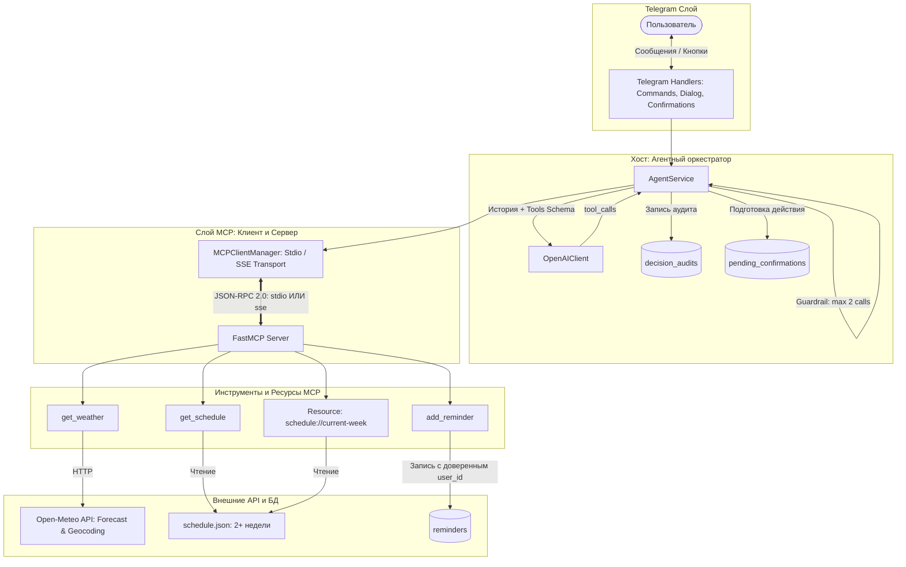

# План выполнения Лабораторной работы № 2 и текущее состояние проекта

Документ фиксирует исходное состояние кодовой базы по итогам Лабораторной работы № 1, архитектурные решения и детальный пошаговый план реализации Лабораторной работы № 2 («Telegram-агент с MCP-инструментами»).

---

## 1. Сведения о текущем состоянии проекта (Baseline)

### 1.1. Итоги Лабораторной работы № 1
* **Репозиторий:** синхронизирован с апстримом `git@github.com:LegionerSV/itmo-tg-template.git` (ветка `main` объединена без конфликтов, коммит `f13bdaa`).
* **Тесты:** 91 пройден успешно, 1 пропущен (`91 passed, 1 skipped in ~13s`). Линтер `ruff` и форматтер проходят без замечаний.
* **Отчёт по Лаб 1:** оформлен в [docs/report-lab1.md](file:///home/krypton/Dev/itmo/ai-in-sd-bot/docs/report-lab1.md).
* **Базовый датасет Лаб 2:** подтянут из апстрима в [docs/evaluation/lab2-routing.json](file:///home/krypton/Dev/itmo/ai-in-sd-bot/docs/evaluation/lab2-routing.json).

### 1.2. Текущая архитектура кодовой базы
1. **Слой представления (Telegram Handlers):**
   * [app/handlers/commands.py](file:///home/krypton/Dev/itmo/ai-in-sd-bot/app/handlers/commands.py): команды `/start`, `/reset`, `/settings` (выбор температуры `0.0`, `0.3`, `0.7`, `1.0`), переключение режимов.
   * [app/handlers/dialog.py](file:///home/krypton/Dev/itmo/ai-in-sd-bot/app/handlers/dialog.py): текстовые сообщения, typing-индикатор, чанкинг ответов $>4096$ символов.
2. **Сервисный слой (Service Layer):**
   * [app/services/dialog_service.py](file:///home/krypton/Dev/itmo/ai-in-sd-bot/app/services/dialog_service.py): координация диалога, компактизация контекста при превышении лимитов, скользящее окно (Sliding Window), изоляция очереди запросов на пользователя через `UserQueueManager`.
3. **Хранилище данных (PostgreSQL + asyncpg):**
   * Транзакционный раннер миграций с блокировкой `pg_advisory_lock` и проверкой контрольных сумм SHA-256 ([app/db/migrations/runner.py](file:///home/krypton/Dev/itmo/ai-in-sd-bot/app/db/migrations/runner.py)).
   * Таблица `user_settings`: хранение `user_id`, `current_mode`, `temperature`.
   * Таблица `dialog_messages`: **уже поддерживает** `role IN ('user', 'assistant', 'system', 'tool')` и поле `metadata JSONB` (архитектурный задел под вызовы инструментов).
4. **Схемы и валидация (Pydantic v2):**
   * [app/core/schemas/message.py](file:///home/krypton/Dev/itmo/ai-in-sd-bot/app/core/schemas/message.py): `ChatMessage` с поддержкой `role=tool`, `tool_call_id`, `metadata`.
   * [app/core/schemas/llm.py](file:///home/krypton/Dev/itmo/ai-in-sd-bot/app/core/schemas/llm.py): `ToolCall`, `LLMRequest`, `LLMResponse`.
5. **Интеграция с LLM:**
   * [app/llm/client.py](file:///home/krypton/Dev/itmo/ai-in-sd-bot/app/llm/client.py): асинхронный клиент к OpenRouter / OpenAI API на базе `httpx`, обработка таймаутов, автоопределение размера контекстного окна модели.
6. **Безопасность и логирование:**
   * Сквозной `request_id` (correlation ID) через `contextvars` ([app/core/context.py](file:///home/krypton/Dev/itmo/ai-in-sd-bot/app/core/context.py)).
   * Фильтрация секретов и токенов в логах ([app/logging_setup.py](file:///home/krypton/Dev/itmo/ai-in-sd-bot/app/logging_setup.py)).

---

## 2. Архитектурный замысел Лабораторной работы № 2

Бот превращается в **автономного AI-агента с агентным циклом (Agent Loop)** и подключается к **собственному MCP-серверу**.



### Ключевые инженерные решения:
1. **FastMCP и гибридный транспорт (Hybrid Transport):**
   * **SSE (Server-Sent Events over HTTP)**: запуск сервера как отдельного сервиса `mcp-server` в `compose.yaml` (порт `8000`). Изоляция сбоев, независимый healthcheck, соответствие микросервисной архитектуре.
   * **STDIO**: запуск через stdin/stdout (`python -m app.mcp_server --transport stdio`) для интеграционных тестов (`pytest`) и обязательной независимой проверки через официальный **MCP Inspector** (`npx @modelcontextprotocol/inspector`).
2. **Защита от проблемы «Обманутого помощника» (OWASP Confused Deputy Protection):**
   * Модель **не получает и не формирует** `user_id` или `chat_id` в аргументах инструмента.
   * Аргументы `add_reminder` строго: `{"text": str, "remind_at": str}`.
   * Доверенный `user_id` извлекается приложением из Telegram Update и передаётся на транспортном уровне через `_meta` JSON-RPC или заголовки запроса `X-User-Id`.
   * Прямой вызов инструмента без контекста завершается отказом авторизации.
3. **Двухфазное подтверждение операций с побочными эффектами (Human-in-the-Loop):**
   * Мутирующая операция `add_reminder` не выполняется сразу.
   * Агент нормализует аргументы $\rightarrow$ создаёт отложенное действие (`pending_confirmations`) со сроком жизни (TTL) 5 минут $\rightarrow$ выводит сообщение с кнопками `[Подтвердить]` и `[Отменить]`.
   * Нажатие кнопки проверяет принадлежность пользователю и выполняет вызов с **ключом идемпотентности**, исключая дубликаты при двойном клике или повторном Telegram Update.
4. **Управление часовыми поясами (Temporal Reasoning):**
   * Часовой пояс хранится в формате базы IANA (`Europe/Moscow`) через Python 3.12 `zoneinfo`.
   * Модель не угадывает часовой пояс. Если он не задан, бот просит настроить его через `/timezone <зона>`.

---

## 3. Пошаговый план реализации

### Этап 1. Зависимости, конфигурация и расписание
1. Добавить `mcp>=1.3.0` в `pyproject.toml`, `requirements.txt` и `constraints.txt`.
2. Добавить `freezegun>=1.5.0` в `requirements-dev.txt` для детерминированного тестирования времени.
3. Расширить [app/config.py](file:///home/krypton/Dev/itmo/ai-in-sd-bot/app/config.py):
   * `mcp_transport: str = "sse"` (допустимо `"stdio"`)
   * `mcp_server_url: str = "http://127.0.0.1:8000/sse"`
   * `mcp_timeout: float = 10.0`
   * `agent_max_iterations: int = 2`
   * `schedule_file_path: Path = Path("app/data/schedule.json")`
4. Подготовить обезличенный файл расписания [app/data/schedule.json](file:///home/krypton/Dev/itmo/ai-in-sd-bot/app/data/schedule.json) минимум на 2–3 недели с полями `start`, `end`, `title`, `location`.

### Этап 2. Схема базы данных и репозитории
1. Создать миграцию `app/db/migrations/sql/0002_lab2_agent_schema.sql`:
   * Колонка `timezone VARCHAR(64) DEFAULT NULL` в `user_settings`.
   * Таблица `reminders` (id, user_id, text, remind_at, timezone, idempotency_key UNIQUE, created_at).
   * Таблица `pending_confirmations` (id UUID/token, user_id, action, payload JSONB, status, expires_at, created_at).
   * Таблица `decision_audits` (id, user_id, action, tool_name, arguments_summary, validation_status, execution_status, rationale, created_at).
2. Реализовать репозитории:
   * `app/db/repositories/reminder_repo.py`: создание напоминания с защитой от дублей.
   * `app/db/repositories/confirmation_repo.py`: атомарное управление состояниями подтверждений с контролем TTL.
   * `app/db/repositories/audit_repo.py`: сохранение и извлечение последнего решения для команды `/why`.
   * Расширить `user_repo.py` методами `get_user_timezone` и `set_user_timezone`.

### Этап 3. Разработка MCP-сервера (`app/mcp_server/`)
1. Создать модуль `app/mcp_server/server.py` на базе `FastMCP`:
   * Точка входа с поддержкой флагов `--transport stdio` и `--transport sse --port 8000`.
2. Реализовать инструмент `get_weather(city: str)`:
   * Геокодирование и прогноз через Open-Meteo API.
   * Обработка неоднозначности: при наличии нескольких одноимённых городов возвращается список вариантов с регионами/странами (автовыбор первого запрещён!).
   * Обработка таймаутов, пустых результатов и сетевых сбоев.
3. Реализовать инструмент `get_schedule(date: str)`:
   * Валидация даты ISO 8601 (`YYYY-MM-DD`).
   * Поиск занятий в `schedule.json`, пустой список при отсутствии пар.
4. Реализовать инструмент `add_reminder(text: str, remind_at: str)`:
   * Проверка доверенного контекста `user_id` (отказ при отсутствии).
   * Валидация будущего времени и наличия таймзоны.
   * Создание записи через `reminder_repo`.
5. Реализовать ресурс `schedule://current-week`:
   * Вычисление диапазона понедельник 00:00 — воскресенье 23:59 в часовом поясе.
   * Корректная группировка на границах месяцев и года.

### Этап 4. MCP-клиент и Агентный цикл (`app/services/agent_service.py`)
1. Реализовать `app/core/mcp/client.py`:
   * Менеджер соединения `MCPClientManager` (поддержка `sse_client` и `stdio_client`).
   * `list_tools()` и `list_resources()`.
   * Конвертация MCP Tool Schemas в формат OpenAI `tools`.
   * `call_tool(name, arguments, user_context)`.
2. Реализовать `AgentService`:
   * Загрузка часового пояса пользователя.
   * Передача схемы инструментов в LLM.
   * Обработка решения модели:
     * Обычный текстовый ответ.
     * Запрос уточнения (`clarify`).
     * Вызов инструмента (`call_tool`).
   * Защита агентного цикла: лимит не более 2 вызовов на одно сообщение пользователя.
   * Маршрутизация `add_reminder` через создание `pending_confirmation` без немедленного вызова мутации.
   * Запись событий в `decision_audits`.

### Этап 5. Команды Telegram-бота и UI подтверждений
1. Обновить [app/handlers/commands.py](file:///home/krypton/Dev/itmo/ai-in-sd-bot/app/handlers/commands.py):
   * `/start` — обновлённое приветствие со всеми командами.
   * `/tools` — динамический вывод списка инструментов от MCP-сервера с пометками `(чтение)` и `(изменение, нужно подтверждение)`.
   * `/timezone <зона>` — валидация IANA-зоны, сохранение, вывод локального времени. Без аргументов — показ текущей зоны.
   * `/why` — отображение последнего решения из `decision_audits` (время, действие, инструмент, аргументы, валидация, статус, причина).
2. Реализовать [app/handlers/confirmations.py](file:///home/krypton/Dev/itmo/ai-in-sd-bot/app/handlers/confirmations.py):
   * Callback-хэндлеры для inline-кнопок «Подтвердить» и «Отменить».
   * Проверка `user_id` (защита от нажатия чужими пользователями).
   * Проверка TTL (5 минут) и вызов MCP-инструмента `add_reminder` при подтверждении.

### Этап 6. Обязательная документация спецификации проекта
В корне репозитория создаются файлы в строгом соответствии с требованиями методички:
1. `AGENTS.md`: назначение каталогов, команды запуска/тестов, архитектурные границы, запрет секретов.
2. `spec.md`: пользовательские сценарии, контракты 3 инструментов и 1 ресурса, машина состояний подтверждения, ограничения цикла.
3. `plan.md`: матрица трассировки требований, план реализации, отметки о выполнении.
4. `docs/plans/lab2/01-agent-and-mcp-architecture.md`: версионированный план архитектуры в каталоге документации.

### Этап 7. Инфраструктура Docker Compose
1. Добавить сервис `mcp-server` в [compose.yaml](file:///home/krypton/Dev/itmo/ai-in-sd-bot/compose.yaml):
   * Команда: `python -m app.mcp_server --transport sse --port 8000`.
   * Healthcheck и связь с `bot` через внутреннюю сеть.
2. Обновить переменные окружения в `.env.example` (`MCP_TRANSPORT=sse`, `MCP_SERVER_URL=http://mcp-server:8000/sse`).

### Этап 8. Эксперимент и оценка качества (Evals)
1. Реализовать скрипт `scripts/run_routing_eval.py`:
   * Загрузка 12 эталонных сценариев из [docs/evaluation/lab2-routing.json](file:///home/krypton/Dev/itmo/ai-in-sd-bot/docs/evaluation/lab2-routing.json).
   * Вызов агента с фиксированным контекстом (`now=2026-10-12T09:00:00+03:00`, `timezone=Europe/Moscow`).
   * Расчёт метрик:
     $$\text{routing\_accuracy} = \frac{\text{правильные действия}}{12} \ge \frac{10}{12}$$
     $$\text{argument\_accuracy} = \frac{\text{правильные аргументы}}{9} \ge \frac{8}{9}$$
   * Вывод итоговой таблицы в формате Markdown.

### Этап 9. Автоматическое тестирование и сдача
1. Реализовать 14 обязательных тестов из методички:
   * Погода: существующий город, город не найден, таймаут/сбой API.
   * Расписание: дата с занятиями, дата без занятий, неверный формат даты.
   * Напоминание: будущее время после подтверждения, прошедшее время/пустой текст (отказ), идемпотентность по ключу, повторный update и конкурентное подтверждение в реальном PostgreSQL.
   * Изоляция: невозможность подтвердить чужое действие.
   * Ресурс: неделя на стыке месяцев и года.
   * Часовые пояса: невалидная зона и локальное время без зоны.
   * Защита: неизвестный инструмент и лишние аргументы отклоняются.
2. Негативные сценарии безопасности (prompt injection в результатах инструмента, попытка извлечь системный промпт).
3. Полный прогон тестового набора:
   ```bash
   uv run pytest -v
   uv run ruff check .
   uv run ruff format --check .
   ```
4. Фиксация тега `lab2`.
