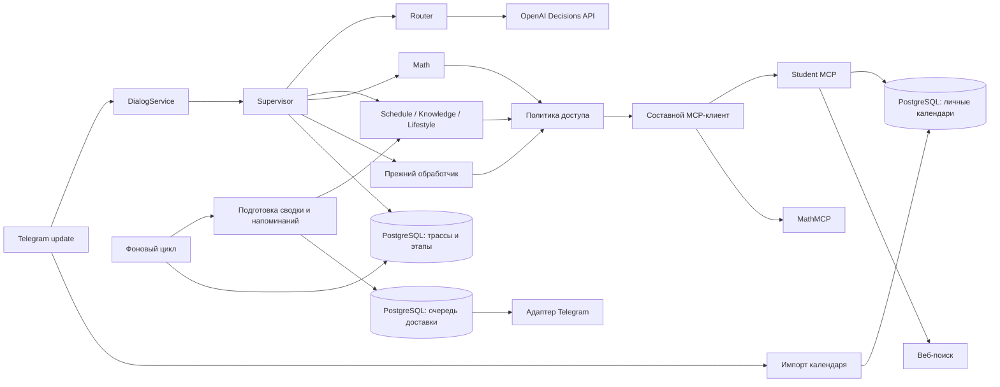

# План 11. Lab 3 — специалисты, уведомления и трассировка

Статус — запланирован. Прежний номер — 08 в Lab 3.
Основа — [MathMCP и составной клиент](../lab2/08-math-mcp.md) и
[повседневный помощник с общим каталогом MCP](../lab2/09-everyday-assistant.md).
Перед началом завершить [план 10](../lab2/10-config-and-mathmcp-acceptance.md).
Требования и критерии приёмки — в [методичке Lab 3](../../labs-guide.md#lab3).

Цель — сохранить работающие сценарии бота, распределить предметные запросы между
четырьмя специалистами, добавить поиск по лекциям и веб-источникам, импортировать
личное расписание, доставлять напоминания и ежедневную сводку с восстановлением
после перезапуска и показывать пользователю техническую трассу его операции.

## Архитектура и контракты

- `DialogService` сохраняет очередь, историю, повторную выдачу и общий дедлайн.
  `Supervisor` валидирует решение Router и вызывает одного специалиста для пользовательского
  запроса. Независимые задачи для разных специалистов и неизвестный маршрут ведут
  к уточнению. Расписание и подготовку напоминаний выполняет Schedule, погоду —
  Lifestyle, поиск по учебным и веб-источникам — Knowledge, математические задачи
  и графики — Math. Для перевода и общих вопросов использовать `legacy`.
  Маршрут определяется задачей, а выбранная пользователем роль задаёт профиль ответа.
- Ввести строгие Pydantic-контракты `SpecialistRequest` и `SpecialistResult`, сохранив
  существующий `AgentResult` на границе диалога. В запросе приложение устанавливает
  `actor_id`, `request_id`, `trace_id`, момент запуска и зону IANA. В модель передаётся
  только необходимый текстовый контекст. Результат содержит статус, публичный текст и
  дискриминированные факты расписания, источников, погоды, математических вычислений
  или пустого результата. Статус, фактические вызовы и коды ошибок записывает
  приложение по результатам выполнения.
  `StrEnum` фиксирует сериализованные состояния.
- Специалисты работают внутри процесса бота и переиспользуют цикл вызова инструментов,
  где это сохраняет контракты. В отчёте описать вынос Knowledge Agent в A2A-сервис с
  Agent Card, аутентификацией и передачей состояния задачи. A2A-сервер и экспорт
  OpenTelemetry остаются расширениями.

## Router через OpenAI Decisions API

- Выполнять один запрос `choice` с именем `route` через `AsyncOpenAI` и
  `client.decisions.create` в адаптере `app/llm`. Передавать текущее сообщение,
  необходимый фрагмент истории и описания вариантов `schedule`, `knowledge`,
  `lifestyle`, `math`, `clarify`, `legacy`. Router работает без доступа к MCP.
  Просьба найти или объяснить материал по источнику идёт в `knowledge`. Решение,
  проверка вычислений, построение графика и продолжение математического диалога
  идут в `math`. Сравнение лекции с веб-источником выполняет Knowledge.
- По умолчанию использовать модель `gpt-6-luna-decision` через OpenCode Go и
  `POST https://opencode.ai/inference/go/openai/v1/decisions`. Базовый URL и имя
  модели вынести в отдельную секцию `[router]` в `config.toml`. Модели специалистов
  задаются основным профилем LLM. Если основной профиль тоже использует OpenCode Go,
  Router может использовать `LLM_API_KEY`. При включённой настройке сессии передавать
  `x-opencode-session` в OpenCode Go. Для отдельного ключа Router предусмотреть
  `ROUTER_API_KEY` в `.env`.
- Адаптер проверяет имя и тип ответа, принадлежность `choice` списку маршрутов и
  конечный `confidence` от 0 до 1. Из валидного ответа он формирует внутренний
  `RouteDecision` с `target`, кодом причины приложения и `confidence`.
  Supervisor проверяет решение перед запуском обработчика. При неизвестной цели
  или невалидном ответе приложение запрашивает уточнение. Отказ модели, таймаут
  и сбой API возвращаются как техническая ошибка в рамках дедлайна диалога.
  `confidence` используется для диагностики и эксперимента. Права определяет код.

## Политика доступа

| Компонент | MCP-инструменты | MCP-ресурсы |
| --- | --- | --- |
| Router | — | — |
| Schedule | `get_schedule`, `get_schedule_week`, `add_reminder` с подтверждением | `schedule://current-week` |
| Knowledge | `search_materials`, `search_web` при разрешении пользователя | `materials://catalog` |
| Lifestyle | `get_weather` | — |
| Math | `math_calculate`, `math_solve`, `math_plot` | — |
| Сводка | чтение через соответствующих специалистов | их разрешённые ресурсы |
| Прежний обработчик | инструменты общих сценариев и перевода Lab 2 | ранее доступные URI |

Для внутренних специалистов применять пересечение явного списка имён и текущего
discovery при публикации меню модели и непосредственно перед вызовом или чтением
URI. Новая возможность MCP закрыта по умолчанию для специалиста. Доступность
инструмента для пользователя определяется его маршрутом и общими проверками.
Проверять каждый вызов пакета до побочных эффектов.
Текущую неделю Schedule может читать через `schedule://current-week`. Для следующей
недели и недели по указанной дате использовать `get_schedule_week`. Подтверждения
остаются у отдельного клиента `student_tools`.

Для напоминания связать исходный запрос на создание, маршрут Schedule, проверенные
аргументы, действие в карточке подтверждения и доверенного владельца. При callback
сверять владельца, состояние, срок и сохранённый запрос на действие. Погода, учебные
данные и фоновые запуски не могут инициировать мутацию. Сохранять действующие пределы
агентного цикла и путь доставки PNG.

## Knowledge, лекции и веб-поиск

- В `student_tools` добавить стартовый корпус из трёх обезличенных Markdown-документов
  об MCP, контексте и структурированных ответах, идемпотентности и доставке.
  После получения лекций по двум предметам преобразовать их в Markdown и включить
  в корпус с привязкой к предмету, лекции и разделу. Назначить стабильные ID и
  ссылки на конкретные разделы. В архив для облака и Docker включать утверждённые материалы.
- Knowledge читает `materials://catalog` через MCP. `search_materials` ищет по словам
  в утверждённом корпусе и возвращает ограниченный список фрагментов со ссылками.
  Аргументы принимают запрос, необязательный идентификатор предмета и размер выдачи.
  Пути к файлам берутся из реестра корпуса. Проверить поиск на русских перефразах.
  Если по лекциям ответа нет, сообщить об этом и предложить веб-поиск.
- Добавить в Student MCP инструмент `search_web` с правом только на чтение.
  Вызов разрешается при явном запросе пользователя или согласии на предложенный поиск.
  Бот передаёт разрешение в доверенном контексте, а сервер проверяет его перед вызовом
  поискового провайдера. Провайдера и параметры доступа задавать конфигурацией.
  Отправлять короткий запрос по теме. Возвращать заголовки, ссылки и фрагменты,
  а дату источника — если она известна. При сбое сообщать о недоступности поиска.
- Knowledge использует фрагменты лекций и веб-страниц как данные. Приложение
  сверяет ссылки в ответе с источниками, полученными в текущем запросе. Если
  пользователь просит сравнение, Knowledge может обратиться к обоим источникам
  в рамках одного запуска. Утренняя сводка берёт учебный фокус из корпуса.

## Math Specialist

Math переиспользует существующий агентный цикл и вызывает инструменты MathMCP
для проверки вычислений, решения уравнений и построения 2D- и 3D-графиков.
Поддержать продолжение задачи по истории диалога, общий дедлайн и лимит вызовов.
Изображения возвращаются через существующий путь передачи PNG в Telegram.

## Личное расписание и импорт `.ics`

- Принимать файл iCalendar `.ics` в личном чате Telegram. Владельца брать из
  доверенного update. Обработчик принимает файл и показывает результат, сервис
  валидирует календарь, repository записывает события в PostgreSQL.
- Хранить одно активное расписание на пользователя. Успешный повторный импорт
  целиком заменяет расписание этого пользователя в одной транзакции и сохраняет
  события без дублей. При ошибке разбора или записи сохранять предыдущее расписание.
  Таблицы расписания добавить отдельной миграцией.
- Для `VEVENT` учитывать `UID`, начало и конец, название, место, часовой пояс,
  события на весь день, повторения и их исключения. Время без указанной зоны
  интерпретировать в зоне пользователя. Разворачивать повторения в пределах
  запрошенного интервала. О неподдерживаемых конструкциях сообщать до записи.
- Дневные и недельные запросы, `schedule://current-week` и утренняя сводка читают
  расписание владельца из PostgreSQL. Бот передаёт идентификатор в доверенном
  контексте MCP, а сводка берёт его из фонового задания. Идентификатор исключить
  из аргументов модели. Различать отсутствие импорта, день без занятий и ошибку чтения.
  При отсутствии импорта предложить загрузить файл. Общий JSON использовать в
  демонстрационных сценариях и тестах.

## Настройки и доставка

- Сохранить адрес личного чата из доверенного Telegram update при взаимодействии
  с ботом. Хранить его отдельно от идентификатора владельца. Групповые сообщения,
  текст запроса, ответ модели и инструменты не меняют адрес. Историческим
  пользователям потребуется новое взаимодействие в личном чате, если адрес
  отсутствует. Напоминания без адреса не отправляются.
- Добавить `/city <город, страна>` с геокодированием, показом нормализованного
  города, страны и региона, подтверждением выбора владельцем и сохранением
  координат. Использовать существующий geocoding, проверять истечение и подмену
  callback. Прогноз для сводки запрашивать по сохранённым координатам, сохраняя
  существующий интерфейс городского прогноза.
- `/briefing_on` включает отдельное согласие только после явной настройки зоны
  и сохранения города. `/briefing_off` отключает его, `/notifications` показывает
  город, зону и состояние. Проверять адрес, город, зону и согласие при подготовке
  и непосредственно перед каждой попыткой отправки сводки.
- Новыми миграциями добавить настройки уведомлений, ожидающие подтверждения города,
  исходящие уведомления, трассы и этапы. SQL размещать в repositories. Хранить
  UTC-моменты в PostgreSQL и вычислять локальные сутки через IANA-зону.
  Проверить повторное применение миграций и обновление с базы Lab 2.
- Использовать фоновый `asyncio`-цикл приложения с настраиваемым интервалом и
  внедряемым `Clock`. PostgreSQL хранит состояние и сроки, цикл запрашивает
  готовые записи на старте и каждом тике. Контейнер бота закрывает цикл до пула
  БД и Telegram-сессии. Для обычного запроса цикл не добавляет задержку.
- Для напоминания использовать ключ `reminder:<id>`. Каждое готовое напоминание
  отправляется отдельно, при опоздании до 15 минут включительно — с пометкой,
  после 15 минут — `missed`. Будущее напоминание не захватывается.
- Сводка планируется на 08:00 локального времени и имеет уникальный ключ по
  владельцу и локальной дате. Отправка допустима до 09:00 включительно. После
  простоя обрабатывается максимум одна актуальная сводка, прошедшие даты не
  догоняются. Для переходов времени зафиксировать правило выбора первого
  допустимого локального момента и проверить его с `FrozenClock`.
- Сводка включает занятия из личного расписания и напоминания за локальные сутки,
  текущую погоду для подтверждённого города, короткий учебный фокус со ссылкой,
  время подготовки и зону. Предметные запросы на чтение можно выполнить параллельно.
  Ограничить каждый раздел и всю сводку дедлайном. Пустое расписание отличается от ошибки
  источника. Частичная сводка сохраняет доступные разделы и объясняет пропуски.
  Учебный фокус брать из доступных документов по воспроизводимому правилу,
  без персонального кэша и без чтения истории пользователя.
- Уникальный ключ события и транзакционная вставка защищают подготовку от
  дублей. Захватывать записи через `FOR UPDATE SKIP LOCKED` и ограниченную
  аренду с идентификатором попытки. Держать транзакции короткими, Telegram
  вызывать после захвата. Состояния — `pending`, `sending`, `retry`, `sent`,
  `failed`, `missed`, `suppressed`. Фиксировать попытку до внешнего вызова.
  Временная ошибка допускает максимум три попытки с задержкой 30 с и 2 мин
  или большей указанной Telegram, пока действует окно. Постоянная ошибка
  завершает задание. После перезапуска забирать истёкшие аренды с теми же
  проверками дедлайна и числа попыток.
- Подготовка идемпотентна. При сбое после отправки и до фиксации `sent`
  сообщение может повториться. Для защиты фиксировать попытку, ограничивать
  повтор оставшимся бюджетом и отражать неопределённый исход в трассе.

## Трасса и безопасность

Создавать UUID трассы для входящего запроса и каждого фонового запуска. Записывать
связанные этапы приёма, Router, специалиста, LLM, MCP, подготовки и доставки.
У этапа есть родитель, время, длительность, компонент, действие и статус.
Имя инструмента, модель, токены от API и код ошибки необязательны. Трассировать
запреты по внутреннему коду и сообщать об отсутствии статистики вместо расчёта
токенов по тексту.

Хранить связь с владельцем в отдельном поле трассы для запроса с фильтром по
владельцу. `/trace last` и `/trace <id>` показывают этапы, длительности, статусы
и имена инструментов. Чужая и отсутствующая трасса дают одинаковый ответ.
Срок хранения по умолчанию 30 дней. Строить диагностику по списку допустимых полей.
Промпты, личные тексты, аргументы напоминания, содержимое календарей, документов и
веб-страниц, фотографии, сырые ответы API, секреты и Telegram ID не входят в логи
и поля этапов.
Существующий `/why` продолжает выдавать разрешённую сводку.

## Очередность реализации и приёмка

| Этап | Результат | Проверка перед следующим этапом |
| --- | --- | --- |
| 1. Контракты, Router, Supervisor | OpenAI Decisions API с моделью Luna по умолчанию, права и диспетчеризация | Один запрос `choice`, проверка ответа, один специалист, безопасное уточнение, запрет неизвестных tools/URI, прежние режимы и PNG |
| 2. Четыре специалиста, импорт и поиск | Личный календарь и `.ics`, подтверждения, учебный корпус, веб-поиск, погода и MathMCP | Дневные и недельные запросы, повторный импорт, изоляция календарей, разрешение на веб-поиск, ссылки на источники, вычисления и PNG |
| 3. Настройки и очередь доставки | Личный адрес, согласие, миграции, состояния и захват | Реальный PostgreSQL, два последовательных и два конкурентных запуска дают одно задание |
| 4. Фоновые сценарии | Напоминания, сводка, повторы и восстановление | Границы 15/60 минут, будущее время, три попытки, постоянная ошибка, перезапуск, частичные данные |
| 5. Трасса и проверка безопасности | Сохранённые этапы, `/trace`, тесты заглушками | Владельцу доступна его трасса, чужая закрыта, запрещённые поля отсутствуют, шесть атак заблокированы |
| 6. Эксперимент и сдача | Проверенный код, документация и отчёт | 15 исходных запросов, как минимум 12 правильных маршрутов, результаты тестов и воспроизводимая команда |

Тесты используют подставные Decisions API, LLM, MCP и Telegram, `FrozenClock` и прямой
запуск тика. Для Router проверить правильный `choice`, неизвестный маршрут, пустой
ответ, отказ, некорректный `confidence`, таймаут и ошибку провайдера.
На PostgreSQL проверить конкурентный захват, откат при ошибке и восстановление
истёкшей аренды. Для расписания проверить успешный и повреждённый `.ics`, повторный
импорт без дублей, часовые пояса и исключения повторений, чтение после перезапуска,
следующую неделю и неделю по дате, отказ при чтении чужого календаря и личные
занятия в сводке. Для Knowledge проверить пустую выдачу, ссылки, явное согласие
на веб-поиск и ложные инструкции в веб-фрагменте. Для Math проверить решение,
продолжение задачи и доставку PNG. Отдельно проверить отсутствие побочных действий
при шести сценариях из методички: чужой инструмент, раскрытие промпта, подмена владельца,
напоминание от Lifestyle, инструкция в документе, ложная инструкция из MCP.
Подтверждение — фактические вызовы адаптеров, записи БД и трасса.

Эксперимент запускать отдельной командой над [исходными 15 запросами](../../evaluation/lab3-routing.json),
с `gpt-6-luna-decision` через OpenCode Go и фиксированными настройками Router.
Сохранять ожидаемый и фактический маршрут, `confidence`, имена реально вызванных
инструментов, задержку Router, полную длительность запроса, статистику токенов и
расход квоты (`opencode.allowance`). Неуспешные запросы входят в знаменатель 15.
Дополнительным набором проверить запросы Math, пограничные случаи между Math и
Knowledge и запросы к веб-источникам. Посчитать результаты этого набора отдельно.
Сохранить базовый прогон, объяснить каждый сбой и повторить ошибочные случаи после
одного обоснованного изменения. Реальные API использовать по явной авторизации.

Финальные проверки — locked pytest, отдельно `RUN_INTEGRATION=1` для Docker
PostgreSQL, ty, Ruff и проверка lock-файла. Обновить `spec.md`, `constitution.md`,
README и архитектурную схему. В `docs/report-lab3.md` собрать диаграммы запроса
и доставки, контракты, права, обезличенную трассу, результаты тестов, таблицы
эксперимента и безопасности, риск повторной доставки и сведения об AI-инструментах.
Зафиксировать итоговый коммит и тег `lab3` после согласования.
