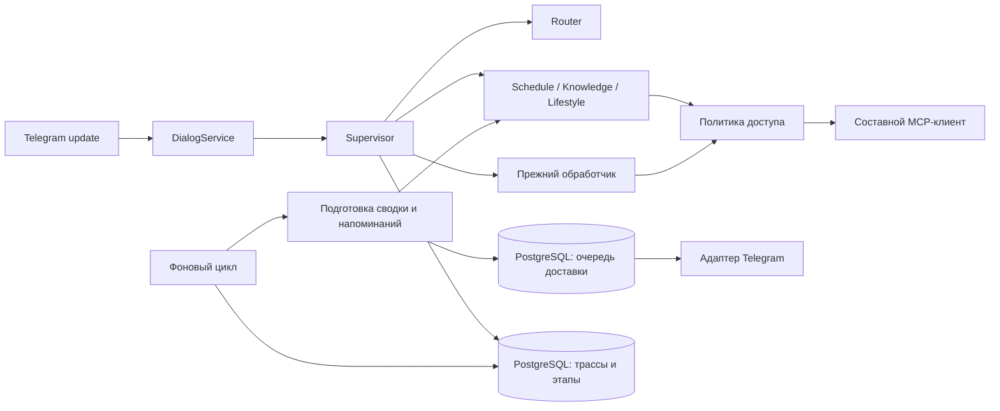

# План 11. Lab 3 — специалисты, уведомления и трассировка

Статус — запланирован. Прежний номер — 08 в Lab 3.
Основа — [MathMCP и составной клиент](../lab2/08-math-mcp.md) и
[повседневный помощник с общим каталогом MCP](../lab2/09-everyday-assistant.md).
Перед началом завершить [план 10](../lab2/10-config-and-mathmcp-acceptance.md).
Требования и критерии приёмки — в [методичке Lab 3](../../labs-guide.md#lab3).

Цель — сохранить работающие сценарии бота, распределить предметные запросы между
специалистами, доставлять напоминания и ежедневную сводку с восстановлением после
перезапуска и показывать пользователю техническую трассу его операции.

## Архитектура и контракты

- `DialogService` сохраняет очередь, историю, повторную выдачу и общий дедлайн.
  `Supervisor` валидирует решение Router и вызывает одного специалиста для пользовательского
  запроса. Смешанный или неизвестный маршрут ведёт к уточнению. Перевод выполняет прежний
  обработчик. Общие вопросы и математические задачи остаются у прежнего обработчика.
  Для этой ветки используем явную цель `legacy` за пределами четырёх эталонных классов
  эксперимента. В остальных случаях Supervisor отправляет прогноз в Lifestyle,
  расписание и подготовку напоминания в Schedule, запрос по материалам в Knowledge.
  Маршрут определяется задачей, а выбранная пользователем роль задаёт профиль
  ответа и сохраняется при маршрутизации.
- `RouteDecision` содержит `target`, код причины и конечный `confidence` от 0 до 1.
  Router получает допустимые цели, текущий запрос и только необходимый фрагмент истории.
  У него нет MCP-доступа. `confidence` собирается для эксперимента и не влияет на права.
  Неизвестная цель или невалидный объект не запускают специалиста. Сбой API отображается
  как техническая ошибка.
- Ввести строгие Pydantic-контракты `SpecialistRequest` и `SpecialistResult`, сохранив
  существующий `AgentResult` на границе диалога. В запросе приложение устанавливает
  `actor_id`, `request_id`, `trace_id`, момент запуска и зону IANA. В модель передаётся
  только необходимый текстовый контекст. Результат содержит статус, публичный текст и
  дискриминированные факты расписания, корпуса, погоды или пустого результата. Статус,
  фактические вызовы и коды ошибок записывает приложение по результатам выполнения.
  `StrEnum` фиксирует сериализованные состояния.
- Специалисты работают внутри процесса бота и переиспользуют цикл вызова инструментов,
  где это сохраняет контракты. В отчёте описать вынос Knowledge Agent в A2A-сервис с
  Agent Card, аутентификацией и передачей состояния задачи. A2A-сервер и экспорт
  OpenTelemetry остаются расширениями.

## Политика доступа и учебный корпус

| Компонент | MCP-инструменты | MCP-ресурсы |
| --- | --- | --- |
| Router | — | — |
| Schedule | `get_schedule`, `add_reminder` с подтверждением | `schedule://current-week` |
| Knowledge | `search_materials` | `materials://catalog` |
| Lifestyle | `get_weather` | — |
| Сводка | чтение через соответствующих специалистов | их разрешённые ресурсы |
| Прежний обработчик | общие возможности Lab 2, включая `math_calculate`, `math_solve`, `math_plot` | ранее доступные URI |

Для внутренних специалистов применять пересечение явного списка имён и текущего
discovery при публикации меню модели и непосредственно перед вызовом или чтением
URI. Новая возможность MCP закрыта по умолчанию для специалиста. Доступность
инструмента для пользователя определяется его маршрутом и общими проверками.
Проверять каждый вызов пакета до побочных эффектов.
Недельное расписание Schedule читает через существующий ресурс, сохраняя доступность
недельных запросов. Подтверждения остаются у отдельного клиента `student_tools`.

Для напоминания связать исходный запрос на создание, маршрут Schedule, проверенные
аргументы, действие в карточке подтверждения и доверенного владельца. При callback
сверять владельца, состояние, срок и сохранённый запрос на действие. Погода, учебные
данные и фоновые запуски не могут инициировать мутацию. Сохранять действующие пределы
агентного цикла и путь доставки PNG.

В `student_tools` добавить как минимум три обезличенных Markdown-документа об MCP,
контексте и структурированных ответах, идемпотентности и доставке. Каждому назначить
стабильный ID. Поиск по словам работает по явному списку документов и отдаёт короткие
фрагменты с ID и заголовками. Аргументы — запрос и ограниченный размер выдачи,
без путей к файлам. Knowledge читает каталог через MCP перед первым обращением в
рамках запуска и передаёт его в контекст как данные. Ссылки в ответе сверяются с
полученными источниками. Для пустой выдачи нужен явный результат «в материалах
ответа нет». Архив для облака и Docker включают только утверждённый корпус.

## Настройки и доставка

- Сохранить адрес личного чата из доверенного Telegram update при взаимодействии
  с ботом. Хранить его отдельно от идентификатора владельца. Групповые сообщения,
  текст запроса, ответ модели и инструменты не меняют адрес. Историческим
  пользователям потребуется новое взаимодействие в личном чате, если адрес
  отсутствует. Напоминания без адреса не отправляются.
- Добавить `/city <город, страна>` с геокодированием, показом нормализованного
  города, страны и региона, подтверждением выбора владельцем и сохранением
  координат. Использовать существующий geocoding, проверять истечение и подмену
  callback. Прогноз для сводки запрашивать по сохранённым координатам, сохраняя
  существующий интерфейс городского прогноза.
- `/briefing_on` включает отдельное согласие только после явной настройки зоны
  и сохранения города. `/briefing_off` отключает его, `/notifications` показывает
  город, зону и состояние. Проверять адрес, город, зону и согласие при подготовке
  и непосредственно перед каждой попыткой отправки сводки.
- Новыми миграциями добавить настройки уведомлений, ожидающие подтверждения города,
  исходящие уведомления, трассы и этапы. SQL размещать в repositories. Хранить
  UTC-моменты в PostgreSQL и вычислять локальные сутки через IANA-зону.
  Проверить повторное применение миграций и обновление с базы Lab 2.
- Использовать фоновый `asyncio`-цикл приложения с настраиваемым интервалом и
  внедряемым `Clock`. PostgreSQL хранит состояние и сроки, цикл запрашивает
  готовые записи на старте и каждом тике. Контейнер бота закрывает цикл до пула
  БД и Telegram-сессии. Для обычного запроса цикл не добавляет задержку.
- Для напоминания использовать ключ `reminder:<id>`. Каждое готовое напоминание
  отправляется отдельно, при опоздании до 15 минут включительно — с пометкой,
  после 15 минут — `missed`. Будущее напоминание не захватывается.
- Сводка планируется на 08:00 локального времени и имеет уникальный ключ по
  владельцу и локальной дате. Отправка допустима до 09:00 включительно. После
  простоя обрабатывается максимум одна актуальная сводка, прошедшие даты не
  догоняются. Для переходов времени зафиксировать правило выбора первого
  допустимого локального момента и проверить его с `FrozenClock`.
- Сводка включает занятия и напоминания за локальные сутки, текущую погоду для
  подтверждённого города, короткий учебный фокус со ссылкой, время подготовки
  и зону. Предметные запросы на чтение можно выполнить параллельно. Ограничить
  каждый раздел и всю сводку дедлайном. Пустое расписание отличается от ошибки
  источника. Частичная сводка сохраняет доступные разделы и объясняет пропуски.
  Учебный фокус брать из доступных документов по воспроизводимому правилу,
  без персонального кэша и без чтения истории пользователя.
- Уникальный ключ события и транзакционная вставка защищают подготовку от
  дублей. Захватывать записи через `FOR UPDATE SKIP LOCKED` и ограниченную
  аренду с идентификатором попытки. Держать транзакции короткими, Telegram
  вызывать после захвата. Состояния — `pending`, `sending`, `retry`, `sent`,
  `failed`, `missed`, `suppressed`. Фиксировать попытку до внешнего вызова.
  Временная ошибка допускает максимум три попытки с задержкой 30 с и 2 мин
  или большей указанной Telegram, пока действует окно. Постоянная ошибка
  завершает задание. После перезапуска забирать истёкшие аренды с теми же
  проверками дедлайна и числа попыток.
- Подготовка идемпотентна. При сбое после отправки и до фиксации `sent`
  сообщение может повториться. Для защиты фиксировать попытку, ограничивать
  повтор оставшимся бюджетом и отражать неопределённый исход в трассе.

## Трасса и безопасность

Создавать UUID трассы для входящего запроса и каждого фонового запуска. Записывать
связанные этапы приёма, Router, специалиста, LLM, MCP, подготовки и доставки.
У этапа есть родитель, время, длительность, компонент, действие и статус.
Имя инструмента, модель, токены от API и код ошибки необязательны. Трассировать
запреты по внутреннему коду и сообщать об отсутствии статистики вместо расчёта
токенов по тексту.

Хранить связь с владельцем в отдельном поле трассы для запроса с фильтром по
владельцу. `/trace last` и `/trace <id>` показывают этапы, длительности, статусы
и имена инструментов. Чужая и отсутствующая трасса дают одинаковый ответ.
Срок хранения по умолчанию 30 дней. Строить диагностику по списку допустимых полей.
Промпты, личные тексты, аргументы напоминания, содержимое документов, фотографии,
сырые ответы API, секреты и Telegram ID не входят в логи и поля этапов.
Существующий `/why` продолжает выдавать разрешённую сводку.

## Очередность реализации и приёмка

| Этап | Результат | Проверка перед следующим этапом |
| --- | --- | --- |
| 1. Контракты, Router, Supervisor | Типы, права и диспетчеризация, связь с текущим диалогом | Один специалист, безопасное уточнение, запрет неизвестных tools/URI, прежние режимы и PNG |
| 2. Три специалиста и корпус | Расписание и подтверждения, поиск со ссылками, обоснованные погодные советы | Каталог прочитан через discovery, источники и пустая выдача, чужие вызовы отклонены |
| 3. Настройки и очередь доставки | Личный адрес, согласие, миграции, состояния и захват | Реальный PostgreSQL, два последовательных и два конкурентных запуска дают одно задание |
| 4. Фоновые сценарии | Напоминания, сводка, повторы и восстановление | Границы 15/60 минут, будущее время, три попытки, постоянная ошибка, перезапуск, частичные данные |
| 5. Трасса и проверка безопасности | Сохранённые этапы, `/trace`, тесты заглушками | Владельцу доступна его трасса, чужая закрыта, запрещённые поля отсутствуют, шесть атак заблокированы |
| 6. Эксперимент и сдача | Проверенный код, документация и отчёт | 15 исходных запросов, как минимум 12 правильных маршрутов, результаты тестов и воспроизводимая команда |

Тесты используют подставные LLM, MCP и Telegram, `FrozenClock` и прямой запуск тика.
На PostgreSQL проверить конкурентный захват, откат при ошибке и восстановление
истёкшей аренды. Отдельно проверить отсутствие побочных действий при шести
сценариях из методички: чужой инструмент, раскрытие промпта, подмена владельца,
напоминание от Lifestyle, инструкция в документе, ложная инструкция из MCP.
Подтверждение — фактические вызовы адаптеров, записи БД и трасса.

Эксперимент запускать отдельной командой над [исходными 15 запросами](../../evaluation/lab3-routing.json),
с одной моделью и настройками. Сохранять ожидаемый и фактический маршрут,
`confidence`, имена реально вызванных инструментов, длительность и доступные
токены. Неуспешные запросы входят в знаменатель 15. Сохранить базовый прогон,
объяснить каждый сбой и повторить ошибочные случаи после одного обоснованного
изменения. Реальные API использовать по явной авторизации.

Финальные проверки — locked pytest, отдельно `RUN_INTEGRATION=1` для Docker
PostgreSQL, ty, Ruff и проверка lock-файла. Обновить `spec.md`, `constitution.md`,
README и архитектурную схему. В `docs/report-lab3.md` собрать диаграммы запроса
и доставки, контракты, права, обезличенную трассу, результаты тестов, таблицы
эксперимента и безопасности, риск повторной доставки и сведения об AI-инструментах.
Зафиксировать итоговый коммит и тег `lab3` после согласования.
